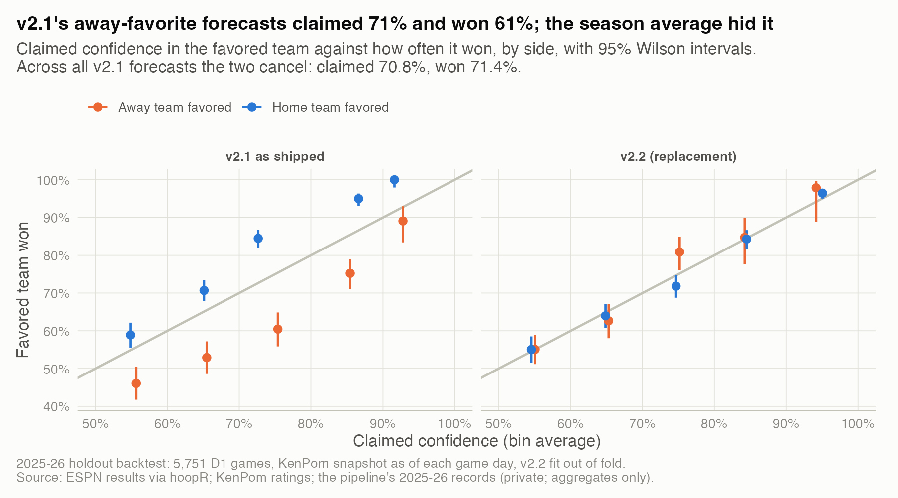
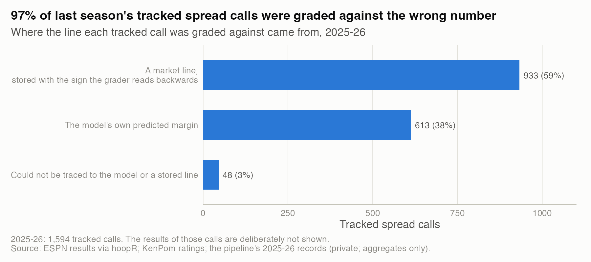
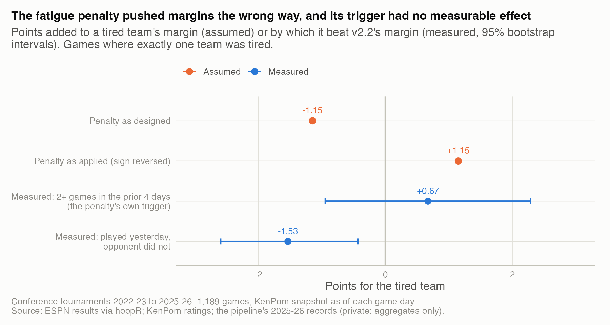

# 01. What I found when I audited last season's model

**Seven defects, two of them high severity, and none visible in the headline numbers.** 97% of last season's tracked spread calls were graded against the wrong number, and the model's away favorites claimed 71% and won 61% (95% CI 58% to 63%, 2,087 games) while its season-wide calibration looked fine (claimed 70.8%, won 71.4%).

| | |
|---|---|
| **Question** | What was wrong with the 2025-26 model (v2.1) and its tracking, how much did each defect matter, and what now stops it from coming back? |
| **Data** | 2025-26: a 5,751-game holdout backtest, the season's 1,841 live predictions and 1,594 tracked spread calls. Conference tournaments 2022-23 to 2025-26 (1,189 games). ESPN via hoopR plus KenPom and market lines (private; aggregates only). |
| **Method** | Model-risk review on 2026-11-05: inventory, severity, detection method, fix and guard for each defect, with each impact measured on held-out data. |
| **Skills shown** | Model risk management, calibration diagnostics, data lineage, root-cause analysis, prioritization. |

## Why it matters
An inherited model comes with numbers that look like evidence. When the evaluation code is broken, a bad model looks tested. Ranking defects by the harm they cause, not by how easy they are to fix, tells you what to trust first.

## What I found

**1. The inventory.** Severity follows one rule. High means the defect silently corrupts a number people rely on, across many games. Medium means it corrupts a report field or a subset. Low means a handful of rows.

| Defect | Severity | Measured impact | Found by | Guard now |
|---|---|---|---|---|
| Self-referential spread evaluation | High | 97% of 1,594 calls graded against the model's own margin or a sign-reversed line | Tracing the grader back to the stored line | One written sign convention; no unit test yet |
| Calibration table applied only when the home team was favored | High | Away-favorite forecasts claimed 71.3%, won 60.6%; Brier 0.1868 vs 0.1786 | Holdout backtest split by side | Backtest prints calibration by side |
| Live margins about twice real margins | Medium | Slope of actual on predicted 0.52 (0.48 to 0.56), 1,841 games | Margin-slope check (this study) | v2.2's margin is in points |
| Model-vs-market disagreement field, sign reversed | Medium | Wrong side in 24% of 1,272 games | Sign audit for the slate | Slate shows all three margins side by side |
| Conference-tournament fatigue penalty, sign reversed | Medium | 52 of 300 games in 2025-26; Brier +0.0002 (CI -0.0006 to +0.0009) | Code review, then a 4-season test | New adjustments need a leave-one-season-out test |
| Postponed 0-0 games graded | Low | 9 of 1,835 graded predictions, all scored as away wins | Status field vs score | Status command counts stale ungraded games |
| Ungraded calls counted as pushes | Low | 34 counted, 18 real; all 43 on 2026-11-05 | Review of a day's summary | Fixed query only |

The full table, with scope and fix for each row, is in `results/defect_inventory.csv`. Entity-resolution defects (four wrong team-name mappings, numeric vs text ids) are covered in study 09.

**2. The calibration defect hid inside a good-looking average.** v2.1 mapped raw probabilities through a lookup table, but only when the home team was favored. Away favorites kept their raw, overconfident number. The table itself shrank home favorites too far. The two errors cancel in the season average, which is why nobody saw them.



*How to read it: points on the diagonal are honest; v2.1's away-favorite forecasts (orange) sit 3 to 15 points below it.* Numbers are in `results/calibration_by_side.csv` and `results/calibration_by_side_bins.csv`.

Patch or replace? Applying the table to both sides recovers 0.0027 of Brier (95% CI 0.0017 to 0.0038). Replacing v2.1 with v2.2 recovers a further 0.0054 (0.0036 to 0.0072), and the patched table still undershoots home favorites by 7 points. So I replaced it (`results/patch_vs_replace.csv`).

**3. The spread tracking measured nothing.** Each tracked call was graded against a stored line. 613 of those lines (38%) were the model's own predicted margin, so the model was graded against itself. Another 933 (59%) were market lines stored with the opposite sign to the one the grader reads. The side of each call also followed the straight-up winner call, not the model's margin against the line. The season's results for these calls are deliberately not shown: they carry no information.



*How to read it: only a call graded against a correctly signed market line could mean anything; at most the 48 untraced calls were.* Counts are in `results/spread_tracking_line_source.csv`.

**4. A fatigue penalty pointed the wrong way, and its premise failed too.** In conference tournaments, step 02 subtracted 1 point from a team with 2+ games in the prior 4 days, and 2 points for 3+ in 5. The sign was reversed, so tired teams gained. Tested the intended way on four seasons, the trigger had no measurable effect: tired teams beat v2.2's margin by +0.67 points (CI -0.95 to +2.28, 149 games). Playing yesterday did matter (-1.53, CI -2.59 to -0.43, 414 games). A 1.9-point back-to-back adjustment replaced the penalty after a leave-one-season-out test, where it improved Brier in 2 of 4 seasons.



*How to read it: orange is what the code assumed, blue is what the games show.* Numbers are in `results/fatigue_penalty_vs_evidence.csv` and `results/fatigue_summary.csv`.

The measured harm was tiny (Brier +0.0002, not distinguishable from zero). It still rates Medium: an untested adjustment shipped with its sign reversed, and nothing would have caught a larger one.

**5. Smaller defects.** The disagreement field (model margin minus market margin) correlated 0.97 with the market's own margin, so it mostly measured how big a favorite the home team was. Live v2.1 margins ran about twice real margins: margin error was 13.3 points against the market's 11.2 on the same 1,272 games. Of the 34 calls counted as pushes, 16 had never been graded. Numbers are in `results/grading_defects.csv`, `results/disagreement_field_sign.csv` and `results/live_margin_scale.csv`.

## How I checked it
- Impacts come from held-out data or the season's own records. The backtest rates each game with that morning's KenPom snapshot and fits v2.2 on the other half of the season. Intervals are Wilson (proportions) or a 2,000-resample paired bootstrap (Brier).
- For the spread tracking, I matched each stored line to the model's margin and to every stored market snapshot. 48 calls (3%) matched neither and are reported as untraced, not counted as wrong.
- The live margin-scale defect was not on the 2026-11-05 fix list; I found it while measuring the disagreement field. v2.2 had already replaced that margin.

## Limitations
- Seven defects is what this review found, not all there were. The live model's internals (volatility and form adjustments) were not audited one by one, because v2.2 replaced them.
- Severity is a judgment with a stated rule, not a score.
- Most guards are a documented convention or a report line. Only the odds client has unit tests.

## What I'd do next
1. Add unit tests for the two sign conventions (stored line and disagreement field) and for symmetry: P(A beats B at a neutral site) + P(B beats A) = 1.
2. Print calibration by side in the daily accuracy report, not only in the backtest.
3. Run the alert rules from study 10 on the live scoreboard, so the next defect of this kind fires within weeks.

## Reproduce
```bash
Rscript studies/01-auditing-an-inherited-model/analysis.R     # from the repo root
```
Needs the private pipeline (KenPom subscription, stored market lines). The exporters (`export_conf_tournaments.py` here, `../02-judging-forecasts/export_forecasts.py`) write per-game files to a temporary folder outside the repo (`CS_PRIVATE_DIR`); only aggregates reach `results/`. Runtime: about 10 seconds.
