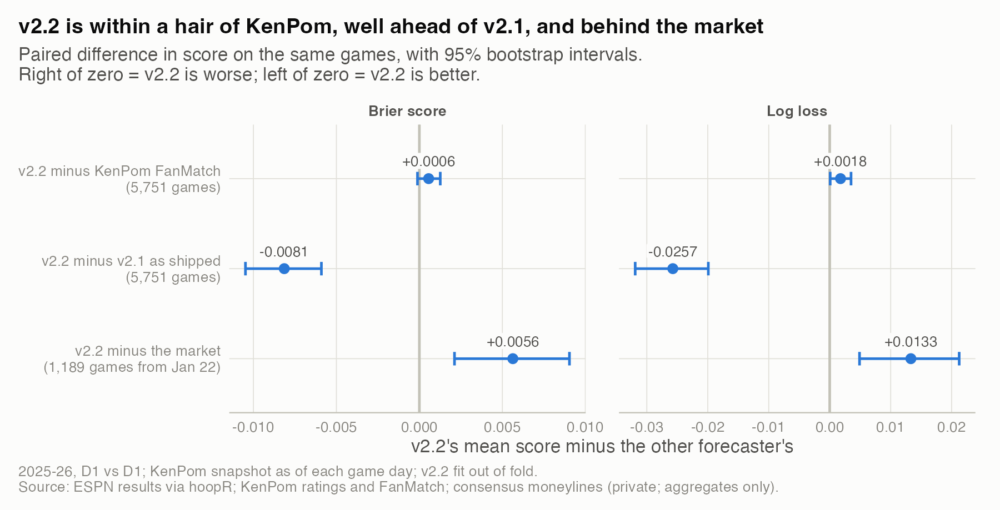
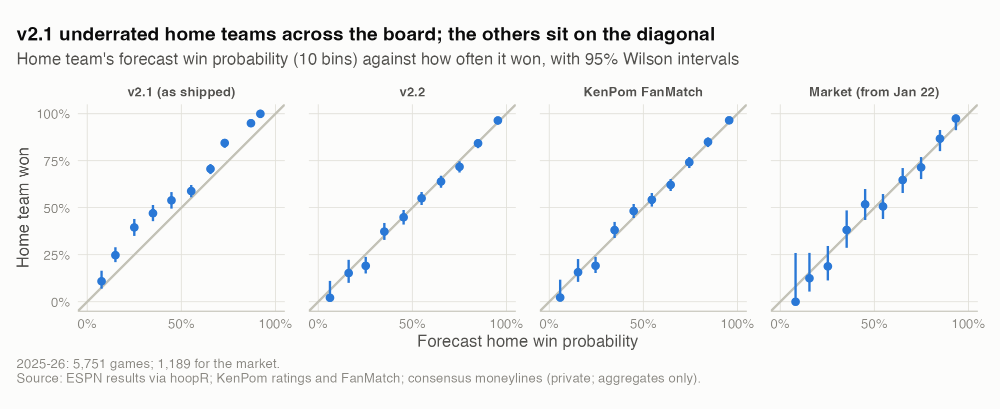
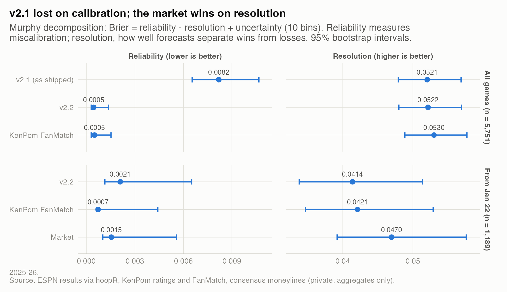
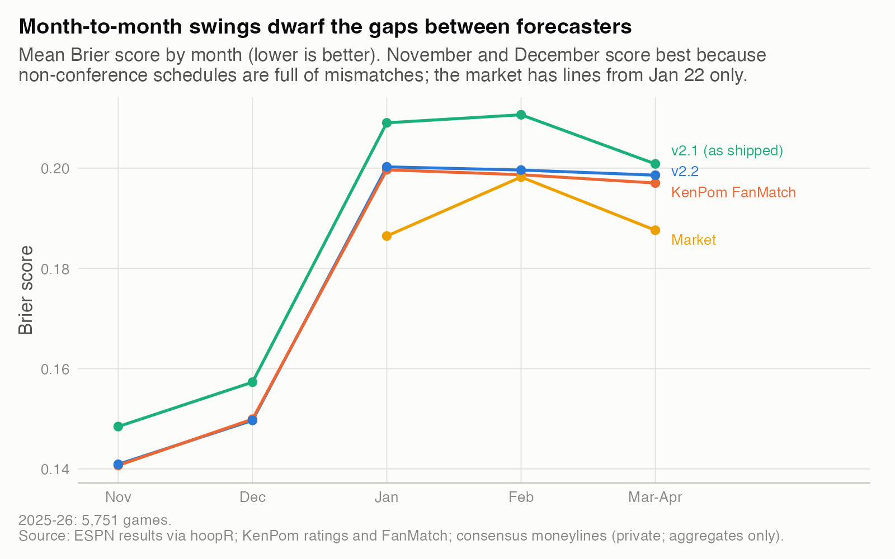
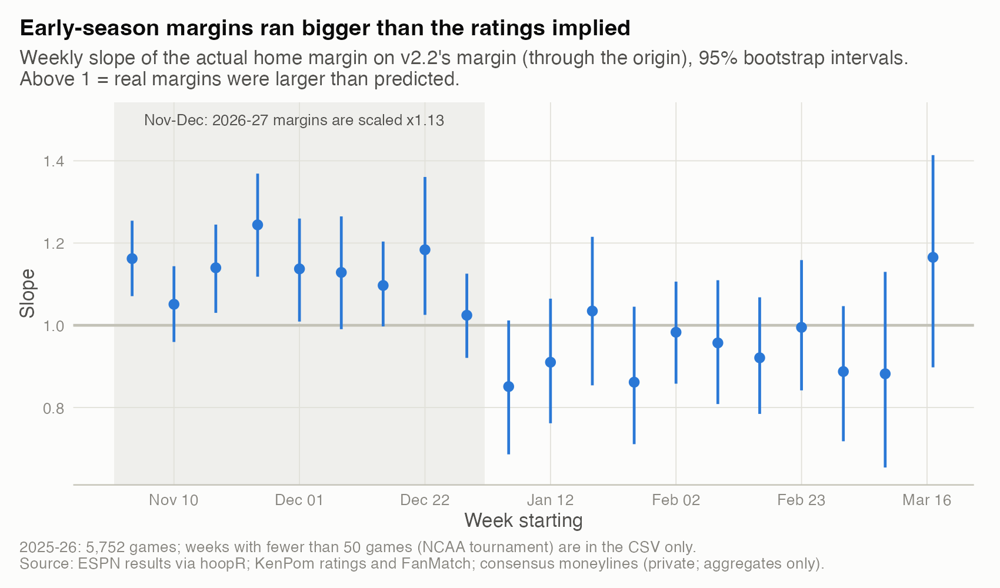

# 02. How good is a simple ratings model, really?

**A three-parameter model matched KenPom's own forecasts and lost to the betting market.** On 5,751 games of 2025-26, v2.2's Brier score was 0.1786 against KenPom FanMatch's 0.1781, a gap of 0.0006 (95% CI -0.0001 to +0.0013). On the 1,189 games where the market's implied probability was recorded, the market beat v2.2 by 0.0056 (0.0021 to 0.0090).

| | |
|---|---|
| **Question** | How well does v2.2 forecast who wins, compared with last season's model, KenPom's published forecasts and the market? |
| **Data** | 2025-26, 5,751 D1 games with every forecaster; 1,189 with a stored market line (from 2026-01-22). ESPN results via hoopR; KenPom daily ratings and FanMatch; consensus moneylines, de-vigged (private; aggregates only). |
| **Method** | No-look-ahead backtest (KenPom snapshot from the morning of each game, v2.2 fit on the other half of the season); Brier, log loss, reliability diagrams, Murphy decomposition, paired bootstrap. |
| **Skills shown** | Probabilistic forecast evaluation, calibration, proper scoring rules, bootstrap inference, benchmarking. |

v2.2 is three numbers: a team's KenPom efficiency margin converted to points with the game's tempo, 3.2 points for the home team, and a normal curve with a spread of 10.8 points to turn the margin into a win probability.

## Why it matters
Straight-up accuracy barely separates these models: 71.4% for v2.1 and 72.3% for v2.2 on the same games. Yet v2.1's probabilities were badly miscalibrated (study 01). Anyone who acts on a probability, whether setting a price, staffing a shift or seeding a bracket, needs to know whether 70% means 70%. Proper scores and calibration answer that; accuracy does not.

## What I found

**1. v2.2 is within a hair of KenPom, well ahead of v2.1, and behind the market.** On Brier, v2.2 and FanMatch are not distinguishable. On log loss, FanMatch is slightly better (0.0018, CI 0.0001 to 0.0035). v2.2 beats v2.1 by 0.0081 Brier (0.0059 to 0.0105).



*How to read it: each bar is v2.2's score minus another forecaster's on the same games; an interval crossing zero means no clear difference.* Numbers are in `results/score_differences.csv` and `results/scores.csv`.

**2. v2.2, FanMatch and the market sit on the diagonal; v2.1 does not.** Home teams won more often than v2.1 said in every bin. That is the signature of its one-sided calibration table.



*How to read it: a point above the line means the home team won more often than forecast.* Numbers are in `results/reliability.csv`.

**3. v2.1 lost on calibration; the market wins on resolution.** The Murphy decomposition splits Brier into reliability (miscalibration, lower is better), resolution (how well forecasts separate wins from losses, higher is better) and the base-rate uncertainty. v2.1 and v2.2 have the same resolution (0.0521 and 0.0522), so v2.1 ranked games as well as v2.2 did; its reliability term was 18 times larger (0.0082 vs 0.0005). On the market's games, calibration is similar for all three, and the market's resolution is higher (0.0470 vs 0.0414). The market knows more; it is not just better calibrated.



*How to read it: compare dots within a column; the market subset has its own uncertainty term.* Numbers, plus a bin-free CORP version as a check, are in `results/murphy_decomposition.csv`.

**4. Compare forecasters on the same games, never across months.** Brier swings from 0.141 in November to 0.200 in January for both v2.2 and FanMatch. November and December look easiest because non-conference schedules are full of mismatches. The gap between v2.2 and FanMatch stays within 0.002 in every month, and every monthly interval includes zero (`results/brier_gap_v22_minus_fanmatch_by_month.csv`).



*How to read it: the lines move together; the space between them is the comparison that matters.* Numbers are in `results/brier_by_month.csv`.

**5. Early-season margins ran bigger than the ratings implied.** Through the origin, the slope of the actual margin on v2.2's margin was 1.14 in November and December (95% CI 1.10 to 1.18, 2,208 games), against 0.94 in January and February (0.89 to 0.99). A likely reason, not tested here: early ratings still lean on preseason priors, so blowouts of weak teams run bigger than predicted. The 2026-27 model now scales its published margin by 1.13 until January 1.



*How to read it: points above 1 mean real margins were bigger than predicted.* Numbers are in `results/margin_slope_by_week.csv` and `results/margin_slope_by_period.csv`.

The scale is stable out of sample: fit on November it is 1.14, fit on December 1.13. The gain in margin error is small, though. Scored on December, mean absolute error falls 0.02 points (CI -0.13 to +0.09). Scored on November, it falls 0.09 points (-0.19 to -0.0001). Win probabilities do not change at all: they depend only on margin divided by sigma, and refitting sigma absorbs the scale (`results/margin_scale_out_of_sample.csv`).

**6. Does the market move toward the model?** If v2.2 knew something the market did not, lines would drift toward v2.2's number between the first and last snapshot. Among games where the line moved and v2.2 differed from the opening line by half a point or more, they moved toward it in 77 of 143 (53.8%, 95% CI 45.7% to 61.8%). For FanMatch it was 97 of 192 (50.5%). Neither is distinguishable from a coin flip, so this test finds no information in v2.2 beyond the market's (`results/line_moves_toward_forecaster.csv`; counts from the pipeline's research note).

## How I checked it
- **No look-ahead.** Teams playing on a given day move 0.095 rating points between the previous snapshot and that day's, and 0.713 between that day's and the next. So the game-day snapshot is pre-game.
- **Out of fold.** v2.2's home court and sigma were fit on one half of the season and scored on the other (2.54 and 11.2 for the first half, 3.89 and 10.7 for the second). Fitting on the full season would flatter v2.2.
- **Same games.** Every comparison is paired, with 2,000 bootstrap resamples of games.
- **Margins too.** Root-mean-square margin error was 11.59 points for v2.2, 11.53 for FanMatch, and 11.17 for the market on its 1,274 games, where v2.2 had 11.4 (`results/margin_error.csv`).
- **What would change the conclusion:** a v2.2-minus-FanMatch interval entirely above zero. On Brier it is not; on log loss it barely is (FanMatch better by 0.0018). So "matches KenPom" means "within 0.002", not "identical".

## Limitations
- One season. The market comparison covers only games from January 22 on, mostly conference games, which are harder to forecast.
- The market line is the first stored snapshot of the day, not the closing line. A closing line would probably score better still.
- Bootstrapping games ignores correlation between games on the same day or with the same team, so the intervals are somewhat too narrow.

## What I'd do next
1. Re-run on 2026-27, which stores lines from opening day in the same orientation as ESPN.
2. Use a block bootstrap by date to get honest intervals.
3. Test an early-season sigma. November and December probabilities had a recalibration slope near 1.2, although a recalibration fit on November did not improve December (study 10).

## Reproduce
```bash
Rscript studies/02-judging-forecasts/analysis.R     # from the repo root
```
Needs the private pipeline (KenPom subscription, stored market lines). `export_forecasts.py` runs the pipeline's backtest code and writes one row per game to a temporary folder outside the repo (`CS_PRIVATE_DIR`); `forecast_tools.R` holds the shared scoring helpers. Only aggregates reach `results/`. Runtime: about 30 seconds.
