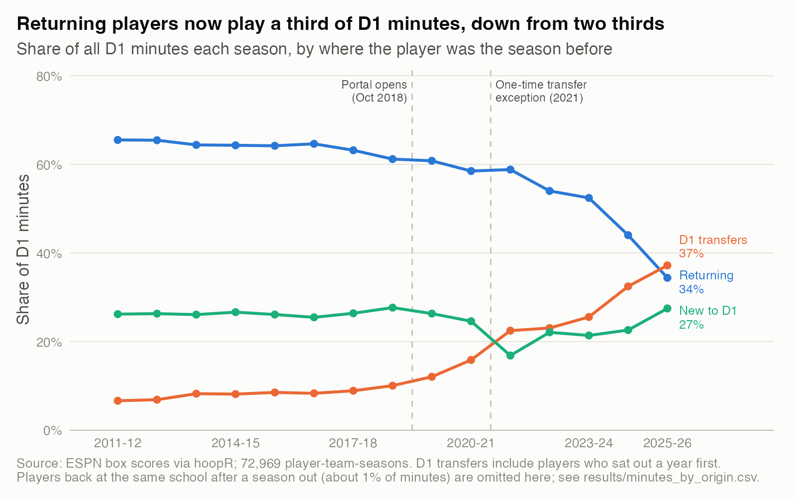
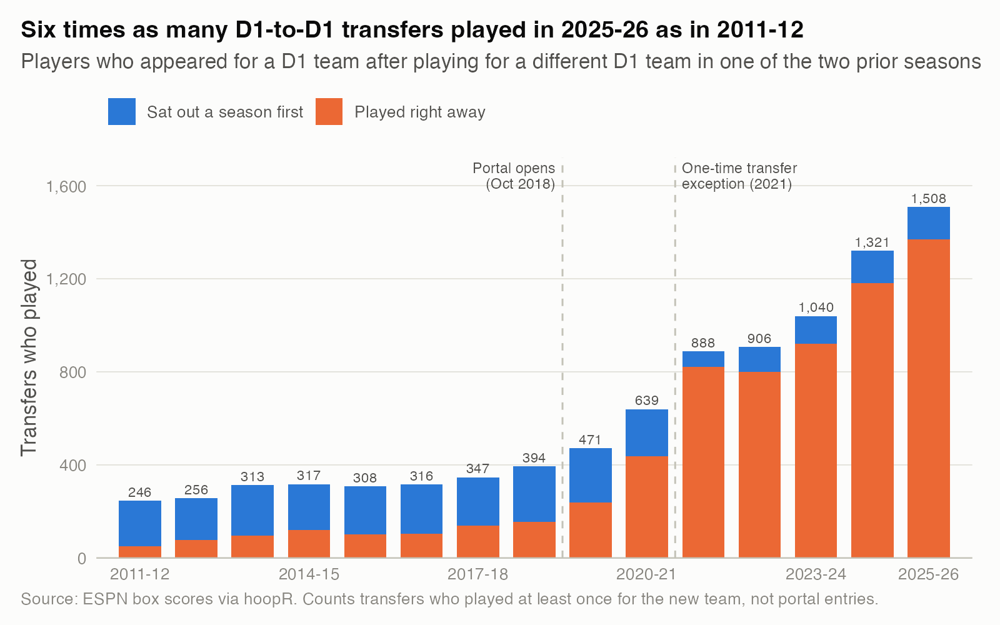
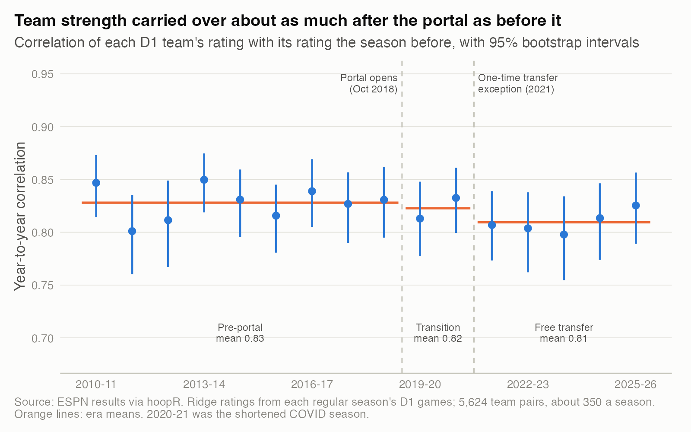
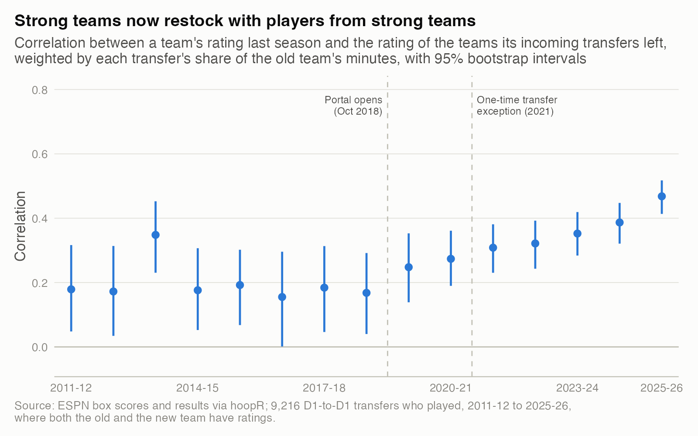
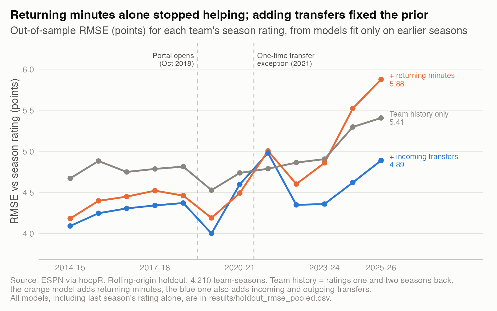

# 03. In the transfer-portal era, how much of a team carries over from one season to the next?

**Rosters now mostly turn over; team strength does not.** Players back with the same team played 34% of D1 minutes in 2025-26, down from 66% in 2011-12, yet a team's rating still correlates 0.81 with its rating the season before (0.83 before the portal; difference −0.02, 95% CI −0.04 to +0.005). The likely reason is that strong programs now restock with transfers from strong teams. A preseason prior that counts arrivals as well as departures beats last season's rating by 0.59 points of RMSE (95% CI 0.51 to 0.67) out of sample.

| | |
|---|---|
| **Question** | How much of a team's roster and strength carries over between seasons, and did that change when transfers became free? |
| **Data** | Public ESPN data via hoopR, 2009-10 to 2025-26: about 90,000 D1 regular-season games and 2.0 million player-game minutes rows; 5,624 team-season pairs. |
| **Method** | Ridge team ratings per season; returning-minutes and transfer features keyed on ESPN athlete ids; team-clustered bootstrap CIs and standard errors; rolling-origin holdout. |
| **Skills shown** | Entity resolution and data-quality checks, feature engineering from event data, bootstrap inference, regression with clustered errors, out-of-sample model comparison. |

## Why it matters
Preseason rankings and forecasts lean on last season's team. Now more than a thousand D1 players change schools each spring. How much of last season should anyone still trust, and what should replace it?

## What I found

**1. Returning players went from two thirds of D1 minutes to one third.** Transfers' share rose from 7% to 37%. Players new to D1 (freshmen, junior-college, lower-division and international arrivals) stayed near a quarter in most seasons. The median team returned 59% of its previous season's minutes in 2011-12 and 26% in 2025-26; one team in ten returned under 4%. 2021-22 paused the slide, likely because the COVID extra year kept seniors around.



*How to read it: each line is a share of all D1 minutes that season.* Numbers: `results/minutes_by_origin.csv`; the team-level spread is in `results/team_continuity.csv`.

**2. Six times as many transfers played, and the 2021 rule changed how.** 246 D1-to-D1 transfers played in 2011-12 and 1,508 in 2025-26. Through 2018-19, most sat out a season first (80% in 2011-12); in 2025-26, 91% played right away. Counts rose steadily after the portal opened and jumped in 2021-22, the first season under the one-time transfer exception.



*How to read it: bar height is the number of transfers who played; colors split them by path.* Numbers: `results/transfers_per_season.csv`.

**3. Team strength carried over about as much as before.** The year-to-year correlation of team ratings averaged 0.83 (95% CI 0.81 to 0.85) from 2010-11 to 2018-19 and 0.81 (0.78 to 0.83) from 2021-22 to 2025-26. In points, the regression slope did not change (era interaction +0.005, SE 0.015). 2025-26, the season with the least continuity, had a correlation of 0.83. The interval rules out a drop larger than about 0.04.



*How to read it: each dot is one season's correlation across about 350 teams; orange lines are era means.* Numbers: `results/persistence_by_season.csv`, `results/persistence_by_era.csv`.

**4. Strong teams now restock from strong teams.** I correlate each incoming transfer's new team (its rating last season) with the player's old team's rating, weighted by the player's share of the old team's minutes. That correlation was 0.16 to 0.19 in seven of eight pre-portal seasons and 0.47 (0.41 to 0.52) in 2025-26. In the free-transfer era, the top fifth of teams drew transfers from teams rated +3.3 on average (+1.3 before the portal), and those players had played the equivalent of 37% of a team's minutes at their old schools (8% before). The bottom fifth drew from teams at −5.0. A transfer from a good team is worth what it always was in the model (coefficient 0.70 before, 0.72 after); the volume and the sorting changed. With roster terms included, the remaining weight on last season's rating is 0.05 lower in the free-transfer era (SE 0.017): more of the carryover now runs through arrivals.



*How to read it: higher means transfers move between teams of similar strength.* Numbers: `results/transfer_sorting.csv`, `results/transfer_sorting_by_quintile.csv`, `results/model_coefficients.csv`.

**5. Roster movement makes a better preseason prior, but only if you count arrivals.** I fixed four nested models in advance. Each is fit only on earlier seasons and tested on the next one (rolling origin, 4,210 team-seasons).

| Out-of-sample RMSE (points) | Test 2014-15 to 2018-19 | Test 2021-22 to 2025-26 | All 12 test seasons |
|---|---|---|---|
| Last season's rating | 4.89 | 5.23 | 5.03 |
| + rating two seasons back | 4.78 | 5.06 | 4.88 |
| + returning minutes | 4.40 | 5.20 | 4.75 |
| + incoming and outgoing transfers | 4.27 | 4.65 | 4.44 |

Returning minutes alone used to cut error by 0.38 points; in the free-transfer era they added error, because departing minutes are now replaced from the portal. The full model beats last season's rating by 0.59 points (0.51 to 0.67), in all 12 test seasons, and two seasons of team history by 0.44 (0.36 to 0.51), in 11 of 12 (all but 2021-22). In the pooled fit, 10 more points of returning-minutes share is worth about 1.1 rating points for an average team; a 30-minute-a-game transfer adds about 1.4 points from an average team and 2.3 from a +10 team. Losing a player to another D1 team costs no more than losing that player to graduation (0.6, SE 0.5).



*How to read it: lower is better; each line adds terms to the gray one.* Numbers: `results/holdout_rmse_pooled.csv`, `results/holdout_rmse_by_season.csv`, `results/holdout_rmse_gain.csv`.

## How I checked it
- **Player ids.** 18 well-known transfers keep one ESPN athlete_id across two to four schools, including Kyle Wiltjer and Anthony Gill, who sat out a year, and P.J. Haggerty, whose box-score name changed spelling (`results/athlete_id_spot_check.csv`). As an upper bound on id splits, new-to-D1 players whose exact name matches a different id in the two prior seasons hold 0.5% to 1.4% of all minutes each season, with no trend; most are namesakes.
- **Coverage.** 98% to 100% of D1 team-games have player box scores, and at least 98.8% of those sum to 200 minutes (±5, plus 25 per overtime). I dropped 8 team-seasons with under 80% coverage, all but one from 2009-10 to 2012-13 (`results/data_quality.csv`).
- **Two-season lookback.** Before 2021, most transfers sat out a year. A one-season lookback would have missed 80% of 2011-12 transfers and exaggerated the growth.
- **Roster definition.** Rosters come from who played. Counting only players who appeared in a team's first five games gives the same result (free-transfer-era RMSE 4.62 vs 4.65).
- **Rating noise.** Split-half reliability of a season's rating is 0.93 to 0.96, except 0.90 in 2020-21. Corrected for it, persistence is 0.88 before the portal and 0.86 after.
- **What would have changed the conclusion:** a free-transfer-era correlation below about 0.78, or a roster-aware prior losing to last season's rating in recent seasons.

## Limitations
- **No coaching changes.** ESPN has no clean coach field, so a new coach is folded into team history, and players who follow a coach look like ordinary transfers.
- **Minutes, not production.** A player's value here is the player's minutes and the old team's rating. Recruiting rankings, class year and per-minute production would sharpen the prior.
- **Rosters from appearances.** A real preseason prior would use published rosters. Players who never played (injured, redshirting) count as departed, and transfers count only if they played for the new team. These are not portal entries.
- **Bundled policy changes.** The one-time exception, name-image-likeness pay (July 2021) and the COVID extra year arrived together, so the eras cannot separate them. 2020-21 also had fewer games and little non-conference play.

## What I'd do next
- Value players by per-minute production from the full hoopR box scores, not team rating alone.
- Add coaching changes from a public source and test whether players who follow a coach carry more value.
- Split persistence into between- and within-conference parts. The spread of team ratings rose from 8.1 points in 2022-23 to 9.9 in 2025-26; is money concentrating strength in the top leagues?

## Reproduce
```bash
Rscript studies/03-the-transfer-portal-era/analysis.R     # from the repo root; public data, cached under data/
```
Public data only (ESPN via hoopR); no private data. Runtime: about 15 seconds from a warm cache.
