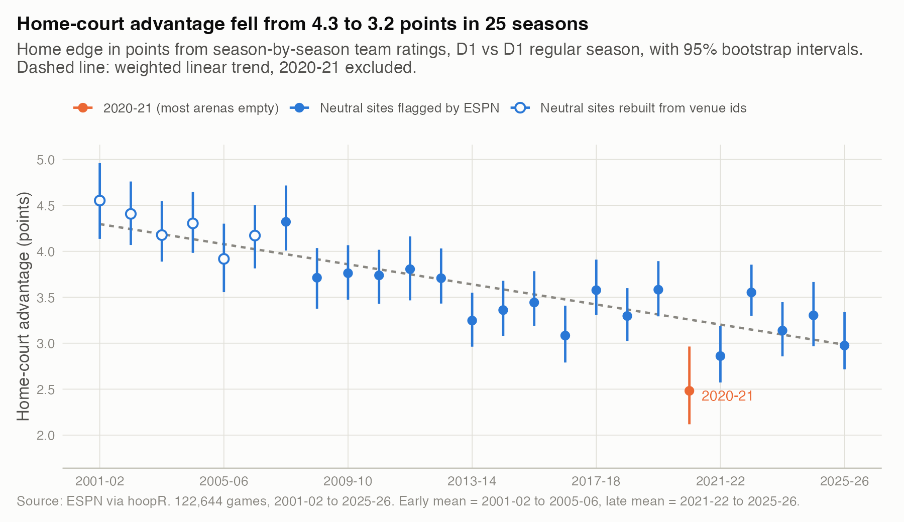
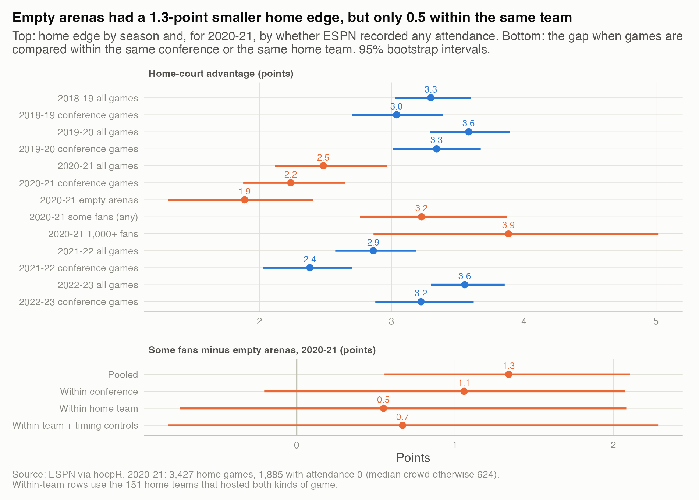
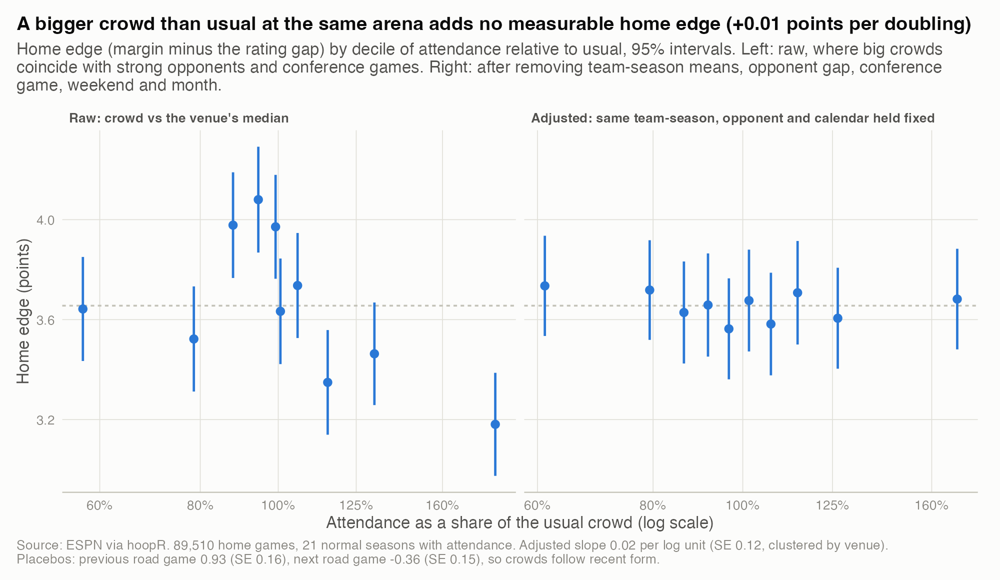
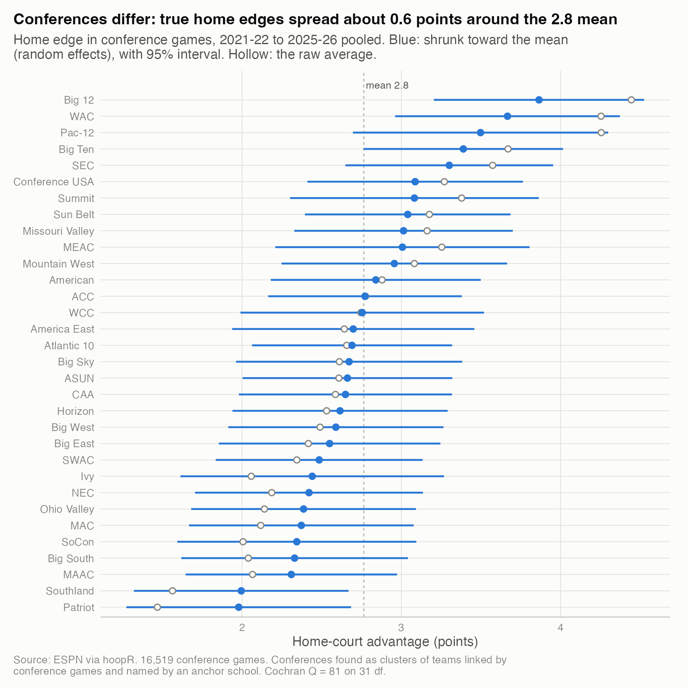
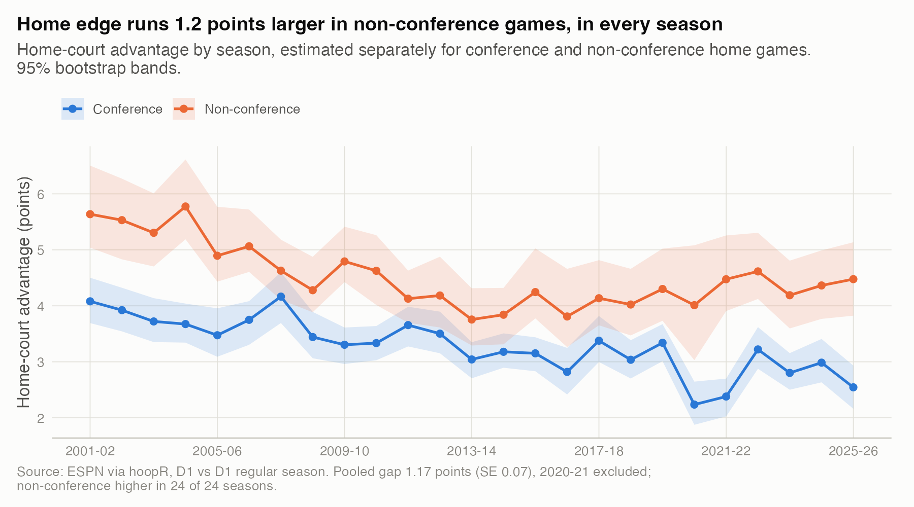

# 04. How big is home-court advantage, is it shrinking, and do crowds cause it?

**Home-court advantage in men's college basketball is about 3.2 points today (2021-22 to 2025-26 average, 95% CI 3.0 to 3.3), down from 4.3 (4.1 to 4.4) twenty years earlier.** Crowds probably account for some of it, but less clearly than the empty-arena season suggests: games without fans in 2020-21 had a 1.3-point smaller home edge, yet within the same home team the gap is 0.5 points (-0.7 to 2.1), and a bigger-than-usual crowd at the same arena adds nothing measurable.

| | |
|---|---|
| **Question** | How many points is playing at home worth, is that changing, and how much comes from the crowd? |
| **Data** | ESPN via hoopR (public). D1 vs D1 regular season, 2001-02 to 2025-26: 122,644 games, 89,510 with usable attendance. |
| **Method** | Season-by-season ridge ratings with a home term and bootstrap CIs; 2020-21 as a natural experiment with conference and home-team fixed effects; within-team-season dose-response with placebo outcomes; random-effects shrinkage by conference. |
| **Skills shown** | Causal inference (natural experiment, fixed effects, placebos), bootstrap and random-effects estimation, data repair (rebuilt neutral-site flags, conferences derived from the schedule graph), literature comparison. |

## Why it matters
Every rating system and forecast carries a home-court term, and a stale one is a built-in error: using 4 points when the truth is 3 tilts thousands of predictions toward the home team. Whether crowds cause it matters to anyone valuing a full arena, or reading 2020-21 as proof.

## What I found

**1. Home-court advantage fell by about a quarter in 25 seasons.**



*How to read it: each dot is one season's home edge, from ratings fit on that season's games.* The 2021-22 to 2025-26 average is 1.1 points below 2001-02 to 2005-06 (95% CI 0.85 to 1.3). The weighted trend is -0.55 points per decade (-0.68 to -0.41), 2020-21 excluded. It is not slower games: per 100 possessions it fell from 6.4 in 2007-08 to 4.3 in 2025-26, while pace stayed between 65 and 70 possessions with no downward drift. Seasons scatter around the trend more than sampling error allows (chi-square 45 on 22 df), so one season can mislead. The median D1 home crowd fell from about 3,800 to 2,700 over the same years, which fits a crowd story, but so does anything else that trended. See `results/hca_by_season.csv` and `results/hca_trend_summary.csv`.

**2. 2020-21: a real drop, but a confounded comparison.**



*How to read it: top, home edge by season and by crowd status in 2020-21; bottom, the fans-minus-empty gap under stricter comparisons.*

- The season as a whole: 2.5 points (2.1 to 3.0), against 3.4 (3.3 to 3.7) in the two seasons before. Part of that is mix: 79% of home games were conference games, against 66% normally, and conference games carry less home edge (finding 4). Conference games alone fell from 3.0-3.3 to 2.2, but in 2021-22, with fans back, they were 2.4.
- Within 2020-21, the 1,885 home games with ESPN attendance 0 had a home edge of 1.9 (1.3 to 2.4); the 1,542 with any fans had 3.2 (2.8 to 3.9).
- Fans were allowed in 95% of Sun Belt and 91% of SEC home games, 8% of Pac-12 and none in the NEC. Within conference the gap is 1.1 (-0.2 to 2.1); within the 151 home teams that hosted both kinds of game it is 0.5 (-0.7 to 2.1), or 0.7 (-0.8 to 2.3) with timing controls.
- In normal seasons a 0 just means missing, and those 668 games show no gap (0.4, SE 0.4), so the 2020-21 gap is not a recording artifact.

See `results/covid_2020_21_hca.csv` and the two other `covid_*` and `placebo_*` files.

**Published ghost-game studies.** For an even matchup, 3.4 points is roughly a 63% home win probability and 1.9 points roughly 57%. European professional basketball fell from 61.7% to 56.0% home wins without spectators ([Alonso et al. 2022](https://doi.org/10.1177/00315125211072483)). Across 15 European football leagues the home edge in points per game nearly halved, 0.39 to 0.22 ([McCarrick et al. 2021](https://doi.org/10.1016/j.psychsport.2021.102013)). A bivariate Poisson reanalysis of 17 soccer leagues found declines in some and increases in others ([Benz and Lopez 2023](https://arxiv.org/abs/2012.14949)). The NBA and NHL bubble playoffs dropped clearly, but also removed travel ([Higgs and Stavness 2021](https://doi.org/10.1038/s41598-021-93533-w)). My pooled estimate sits in that range; the within-team estimate is smaller and uncertain, a check league-level studies cannot run.

**3. A bigger crowd than usual at the same arena adds no measurable edge.**



*How to read it: left, home edge by attendance relative to the venue's median that season; right, the same with team-season, opponent gap, conference game, weekend and month held fixed.* Raw, bigger crowds go with a smaller edge (-0.38 per log unit, SE 0.11) because they come for strong opponents. Adjusted, the edge changes by +0.01 points per doubling of the crowd (-0.14 to +0.17). Attendance is not randomly assigned: crowds swell after a good road result (previous road game slope +0.93, SE 0.16), and the next road game shows -0.36 (SE 0.15). The design rules out a large effect of marginal crowd size, not a small one. See `results/attendance_dose_response_*.csv`.

**4. Home edges differ by conference, and are larger outside conference play.**



*How to read it: blue dots are conference home edges shrunk toward the mean; hollow dots are raw averages.* In 16,519 conference games from 2021-22 to 2025-26 the mean is 2.8 points (2.5 to 3.0), and true conference edges spread with a standard deviation of 0.6 (0.4 to 0.9). The Big 12 is highest (3.9, 3.2 to 4.5) and the Patriot League lowest (2.0, 1.3 to 2.7). Conference home edge correlates with median attendance (r = 0.62, 0.34 to 0.79), but big-crowd conferences also span more miles, and I have no travel data.



*How to read it: home edge by season for each game type.* Non-conference games carry 1.2 points more (SE 0.07), in all 25 seasons. Limiting them to rating gaps under 10 points cuts the gap to about 0.7, so lopsided "buy games" explain part, not all. See `results/hca_by_conference.csv` and `results/hca_conference_*.csv`.

## How I checked it
- **Neutral sites.** ESPN flags them only from 2007-08. I also mark a game neutral when it is not at the home team's most-used venue that season, and drop games with no venue id (up to 20% in 2001-02, none after 2012-13). This agrees with ESPN on 98-99% of games and matches ESPN-flag estimates within 0.04 points from 2013-14 on. Trusting ESPN's flag before 2007-08 would treat every neutral-site game as a home game, understate early home edges by 0.24 to 0.44 points and flatten the trend (`results/data_quality_by_season.csv`, `results/hca_by_season.csv`).
- **Model.** The multi-term ridge used for 2020-21 and conferences reproduces `fit_ratings()` exactly with one home term (asserted in the script).
- **Uncertainty.** 200 bootstrap resamples of games per season; dose-response SEs clustered by venue; Paule-Mandel random effects with a Q-profile interval.
- **What would have changed the conclusion:** a within-team 2020-21 gap with a CI above zero, or an adjusted slope above about 0.3 points per doubling.

## Limitations
- ESPN attendance is the announced figure, often tickets distributed, and 0 means missing outside 2020-21.
- 2020-21 differed in more than crowds: pauses, short-notice games, testing, regional schedules.
- No travel, altitude or time-zone data, so conference gaps and the long decline have no attributed cause.
- The bootstrap treats games as independent.

## What I'd do next
- Geocode venues to separate travel distance from crowd size.
- January 2022 had a small spike in empty arenas (61 games, against about 25 in other months; `results/empty_arena_games_by_month_2021_22.csv`): a second, smaller within-team experiment.
- Test the referee channel: home free-throw and foul differentials in empty versus full arenas.

## Reproduce
```bash
Rscript studies/04-home-court-advantage/analysis.R     # from the repo root; public data, cached under data/
```
Public data only; no KenPom or market data. Runtime: about 2.5 minutes from a warm cache.
