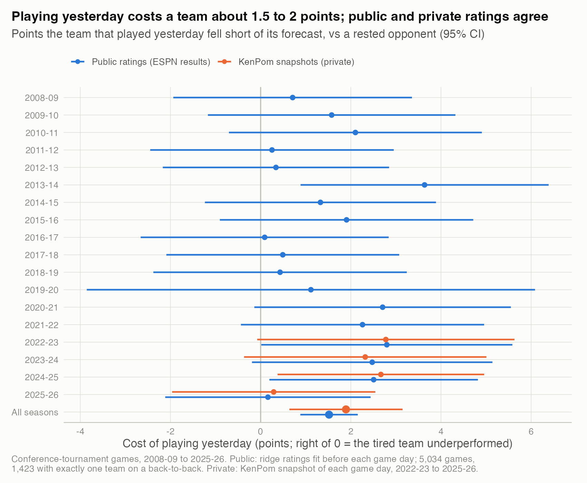
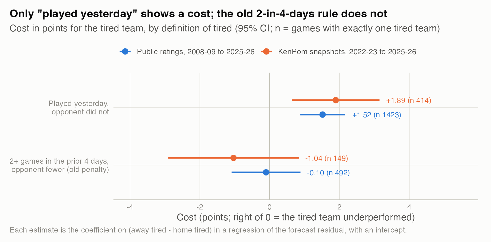
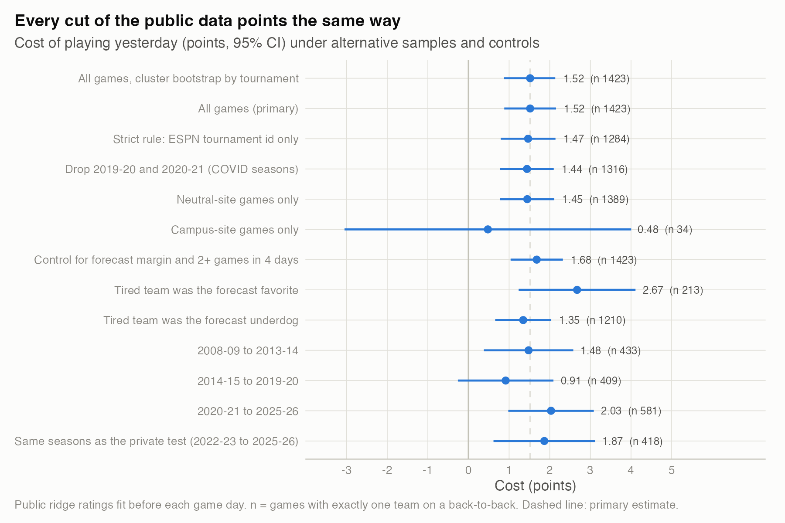
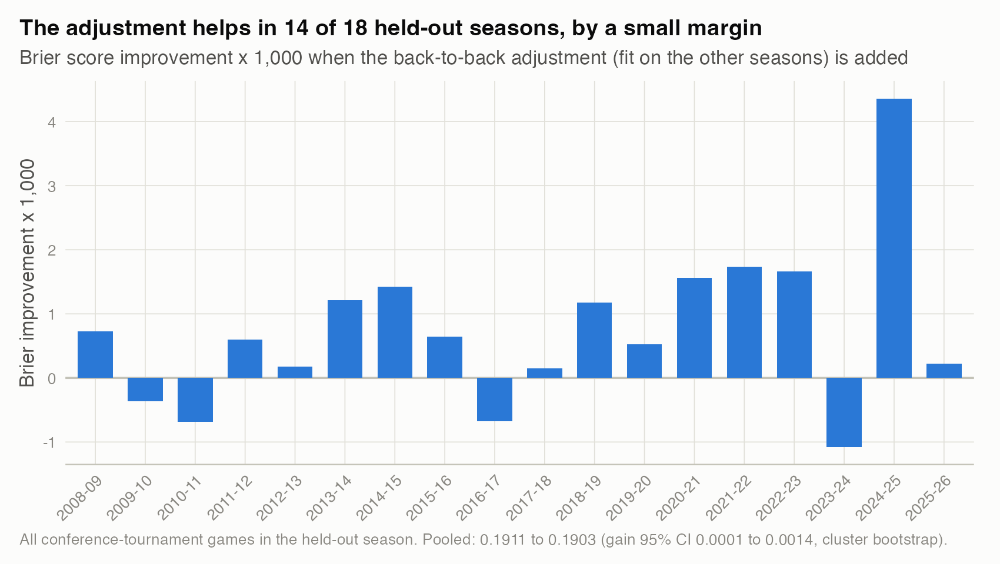

# 05. Does playing yesterday cost a team in a conference tournament?

**Yes: a team that played the day before, facing an opponent that did not, falls about 1.5 points short of its forecast (95% CI 0.9 to 2.1; 1,423 games, 2008-09 to 2025-26).** A test on private KenPom ratings found 1.9 points (95% CI 0.6 to 3.1; 414 games), and the public replication over the same four seasons gives the same number, 1.9.

| | |
|---|---|
| **Question** | When a conference-tournament bracket makes one team play on consecutive days and its opponent does not, does the tired team underperform? |
| **Data** | Public: 5,034 conference-tournament games from ESPN via hoopR, 2008-09 to 2025-26. Private: 1,189 games from 2022-23 to 2025-26, each rated with that day's KenPom snapshot (aggregates only). |
| **Method** | Natural experiment. Ridge ratings fit on games before each game day; the forecast residual is regressed on who played yesterday. Cluster bootstrap by tournament; leave-one-season-out scoring. |
| **Skills shown** | Causal inference from a natural experiment, balance and placebo-style checks, regression with clustered uncertainty, independent replication, out-of-sample validation, finding a sign error in production code. |

## Why it matters
Forecasters, coaches and schedulers all make assumptions about fatigue. The private pipeline behind these studies had carried a hand-set fatigue penalty (-1 point for 2+ games in 4 days, -2 for 3+ in 5) that had never been tested. Testing it showed that it was applied with its sign reversed, so tired teams were being rated up instead of down. It also failed the test in the direction it was meant to work. This study replaces it with an estimate from data.

## Why this is a natural experiment, and why it is not a perfect one
Most conference tournaments give byes to the top seeds. A team that wins an early-round game plays again the next day; the team waiting for it arrives rested. Neither team chooses its rest: the bracket was fixed before the tournament started. So within a game, rest is assigned by the schedule.

It is not random, though. Byes go to better teams. In the 1,423 games with a rest mismatch, the rested team was rated 5.7 points better on average and was the better-rated team 85% of the time (`results/balance.csv`). Raw margins would mix rest with quality. So the outcome is the residual against a rating-based forecast. That forecast already accounts for the quality gap, so the question becomes whether the forecast misses by more when the opponent is rested.

## What I found
**1. Playing yesterday costs about 1.5 to 2 points, and two independent rating systems agree.**



*How to read it: each dot is the points the tired team fell short of its forecast; right of zero means it underperformed.* Pooled, the public estimate is 1.52 points (standard error 0.33). Season by season, the public and private estimates track each other closely: 2.80 and 2.78 in 2022-23, 2.47 and 2.32, 2.51 and 2.67, then 0.16 and 0.29 in 2025-26. Single seasons are noisy (standard errors around 1.4), and 2025-26 shows almost no cost in either system. Numbers: `results/effect_by_season.csv`.

**2. The old "2+ games in 4 days" rule finds nothing.**



*How to read it: same estimate, two definitions of "tired".* Teams with 2+ games in the prior 4 days, facing a fresher opponent, did no worse than forecast: -0.10 points (SE 0.50, 492 games) in public data and -1.04 (SE 0.95, 149 games) in private data. In the private data their plain average was 0.67 points better than forecast (SE 0.86). The cost is about the immediate back-to-back, not a cumulative load.

**3. The estimate survives every alternative sample and control I tried.**



*How to read it: each row re-estimates the cost on a different cut; the dashed line is the primary estimate.* All twelve cuts give a positive point estimate, between 0.5 and 2.7 points. The two that cross zero are small or noisy: campus-site games (34 mismatches) and the 2014-15 to 2019-20 block (0.91, 95% CI -0.26 to 2.09). Numbers: `results/robustness.csv`.

**4. As a forecast adjustment, it helps a little, and fairly consistently.**



*How to read it: bars above zero are held-out seasons where adding the adjustment improved the Brier score.* For each season I fit the points on the other seasons and scored the held-out one. Brier improves in 14 of 18 seasons: 0.1911 to 0.1903 overall (gain 0.0008, 95% CI 0.0001 to 0.0014), and 0.1776 to 0.1749 on the games with a rest mismatch. The private test showed the same pattern at lower power: 0.1969 to 0.1955, better in 2 of 4 seasons. On this evidence, the private model now takes 1.9 points off a team that played yesterday against a rested opponent, in conference tournaments only.

For scale: in 2025-26, the only season with stored market data, the market's forecast already accounted for most of it. On the 31 games with a rest mismatch, the market's margin was 1.34 points (SE 0.22) less favorable to the tired team than the rating forecast. So the adjustment moves the model toward what the market already knew.

## How I checked it
- **The forecast's own bias.** Public ratings overstate margins between unequal teams in these games (residual slope -0.12, SE 0.03). That would make rested favorites look worse, which works against finding a cost. Controlling for the forecast margin raises the estimate to 1.68.
- **Favorites and underdogs.** If the effect came from mis-rated underdogs, it would vanish when the tired team is the favorite. It does not: 2.67 points (213 games) for tired favorites, 1.35 (1,210) for tired underdogs.
- **Sample rules.** ESPN's tournament id is missing for most of 2008-09 and 2020-21. The primary rule also accepts the game notes ("Big Ten Tournament - Quarterfinal"); I audited all 567 notes-only matches. The strict id-only rule gives 1.47.
- **Clustering.** Games in one bracket share a site and schedule. A bootstrap over tournaments gives 0.87 to 2.14, almost the same as the plain standard error.
- **Fixed in advance.** The primary specification copies the private test exactly. Every alternative I ran is in the figure.

What would have changed my mind: the cost disappearing under the forecast-margin control, living only in tired underdogs, or failing to improve held-out Brier.

## Limitations
- The team that played yesterday also won yesterday. Ratings include that game, but a hot streak the ratings miss would hide some cost, so the estimate may be conservative.
- The data cannot separate fatigue from travel, short preparation, or late tip times. It measures the whole package of "played yesterday".
- Public ratings use margins only, with no tempo or recency weighting. The private comparison covers only four seasons.
- This says nothing about the NCAA tournament, which has no back-to-backs.

## What I'd do next
1. Dose-response: minutes played yesterday by the top players (`cbb_player_box`), and overtime yesterday (`ot_periods`).
2. Third games in three days, from double-bye formats, as a separate group.
3. Refit with 2026-27 conference tournaments once they finish, as the private pipeline plans.

## Reproduce
```bash
Rscript studies/05-rest-as-a-natural-experiment/analysis.R     # public data only; about 10 seconds
```
`results/private_benchmark.csv` holds the private aggregates. It is written by `private_benchmark.py`, which needs the private pipeline and a KenPom subscription (`NCAAB_PRIVATE_ROOT=... python3 private_benchmark.py`). `analysis.R` reads that file if it exists and otherwise draws the public series alone.
