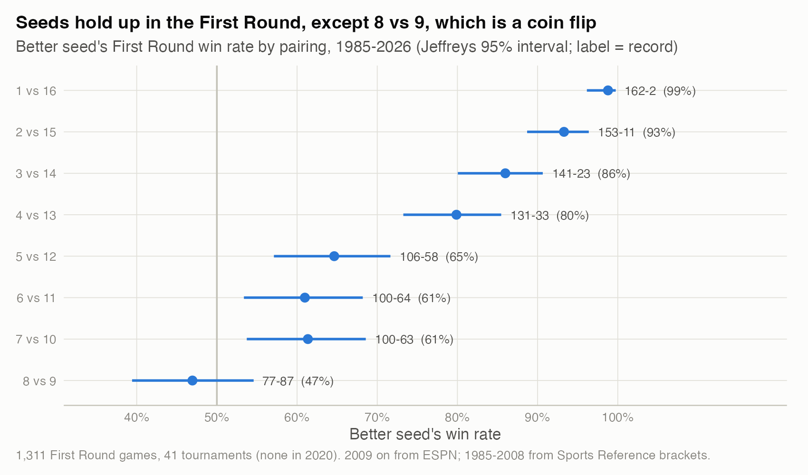
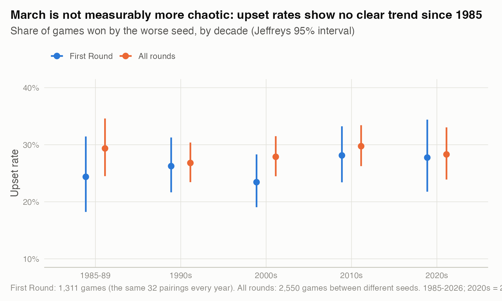
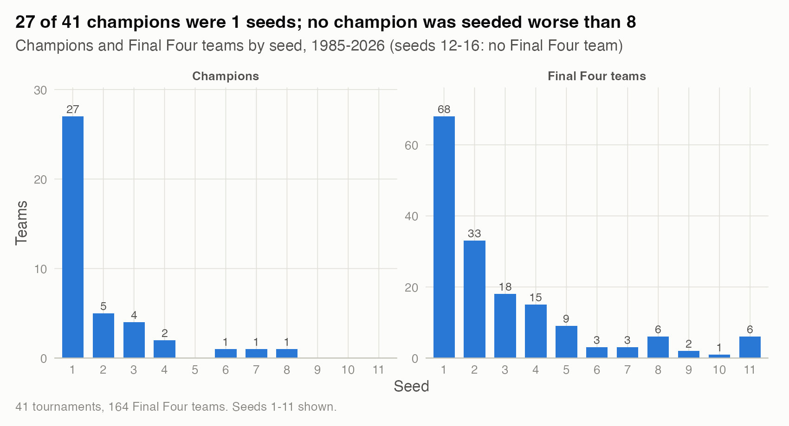
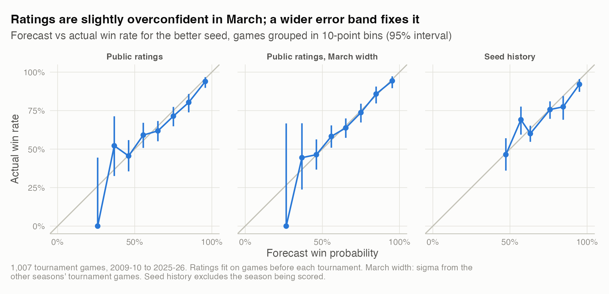
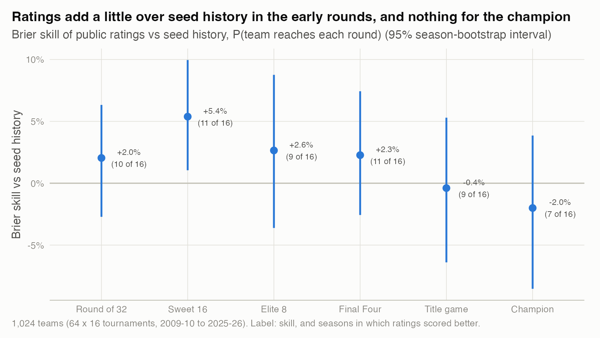
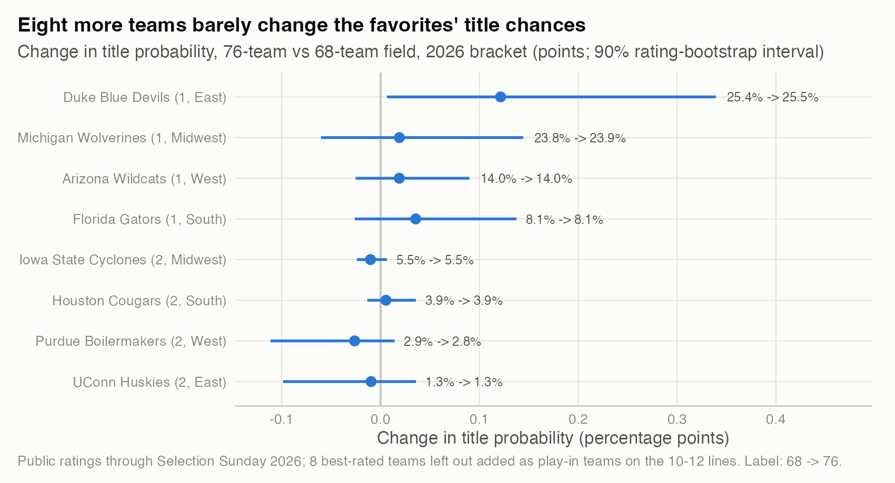

# 06. Forty-one years of March: seeds, upsets and the 76-team field

**Seeds are a strong forecast, upsets are not becoming more common, a public-ratings model beats the seed line only slightly, and adding eight teams to the field barely matters.** Over 1985-2026, 8 vs 9 is a coin flip (8 seeds won 47%, 95% interval 39% to 55%) and the First Round upset rate shows no trend (+0.07 logit per decade, SE 0.06). Ratings score a Brier of 0.187 against 0.194 for seeds (1,007 games), and in a 76-team replay of 2026 the eight added teams share a 0.03% title chance.

| | |
|---|---|
| **Question** | What do 2,644 NCAA tournament games say about seeds and upsets, does a ratings model beat the seed line, and what does the 76-team format change? |
| **Data** | 1985-2026 tournament results with seeds: ESPN from 2009, Sports Reference brackets for 1985-2008 (aggregates only). Public ESPN game results via hoopR, 2009-10 to 2025-26, for ratings. The 2026 bracket. |
| **Method** | Jeffreys intervals and a logistic trend for the seed history. Ridge ratings fit before each tournament, with exact bracket probabilities by dynamic programming, scored against a leave-one-season-out seed table. The 2026 bracket replayed with 8 more teams: exact probabilities, 100,000 simulations and a 200-refit bootstrap of the ratings. |
| **Skills shown** | Binomial inference, probabilistic forecasting and calibration, proper scoring rules, Monte Carlo simulation with an exact cross-check, scenario analysis with stated assumptions. |

## Why it matters
Seeds are the forecast most fans see, and the field grows from 68 to 76 teams in 2026-27. The questions are whether the seed line deserves its reputation, whether a simple rating does better, and what a bigger field changes.

## What I found
**1. The seed line holds, except 8 vs 9.**



*How to read it: the dot is how often the better seed won.* 1 seeds are 162-2 against 16 seeds: 158-2 through 2025, then 4-0 in 2026. 12 seeds beat 5 seeds 35% of the time (58 of 164; 95% interval 28% to 43%). The 8 seed won 77 of 164 against the 9 seed (binomial test against 50%: p = 0.48). There, the seed tells you nothing. Numbers: `results/first_round_pairings.csv`.

**2. March is not getting more chaotic.**



*How to read it: share of games won by the worse seed, by decade.* The First Round is the clean measure, because it has the same 32 pairings every year. Its upset rate ran from 23% to 28% by decade. The logistic trend is +0.07 per decade (95% CI -0.04 to +0.18), and a test across decades gives p = 0.67. All rounds together give the same picture (+0.01 per decade). Numbers: `results/upsets_by_decade.csv`.

**3. Titles go to the top of the bracket.**



*How to read it: counts of champions and Final Four teams by seed.* 27 of 41 champions were 1 seeds, and none was worse than an 8. No 12-16 seed has reached a Final Four. 11 seeds have six Final Four trips, as many as 8 seeds and more than 6, 7, 9 or 10 seeds. Numbers: `results/champion_final_four_seeds.csv`.

**4. Public ratings beat seed history by a little, and are slightly overconfident.**



*How to read it: points on the diagonal mean the forecast probabilities came true at the stated rate.* Ratings were fit on each season's games before the tournament. Seed history uses every other tournament since 1985, so the year being scored is always left out.

On 1,007 games from 2009-10 to 2025-26, the results were:
- **Brier:** 0.187 for ratings vs 0.194 for seeds. The gain is 0.0066, with a 95% season-bootstrap CI of -0.001 to 0.013, so it is not quite distinguishable from zero.
- **Log loss:** 0.552 vs 0.570.

The ratings get the size of margins right (slope 0.99), but tournament errors are wider than the regular-season fit assumes: SD 11.6 points vs 10.1. Using a wider error band taken from the other seasons' tournaments fixes the overconfidence. That version has Brier 0.1867 and a gain of 0.0074 (95% CI 0.0005 to 0.013).

**5. Ratings help in the early rounds, but not for the champion.**



*How to read it: Brier skill of each team's probability of reaching each round, relative to seed history.* The gain peaks at the Sweet 16 (+5.4%, 95% CI +1.0% to +10.0%; better in 11 of 16 seasons). For the champion it is -2.0% (CI -8.5% to +3.9%). Both forecasts gave the eventual champion about 12% on average. One check on the simulation: in the 16 backtest brackets, the model expected 17.7 seed upsets per tournament (18.7 with the wider band), and 18.1 actually happened (`results/upset_count_check.csv`). Numbers: `results/round_brier.csv`.

**6. A 76-team field barely changes who wins.**



*How to read it: change in each top-two seed's title chance when eight teams are added; label shows 68 to 76.* The setup:
- **Ratings:** fit on 2025-26 games through Selection Sunday.
- **Added teams:** the eight best-rated teams left out (Auburn, Indiana, Cincinnati, Oklahoma, Baylor, New Mexico, Washington, San Diego State).
- **Placement:** each added team plays one of the eight lowest-rated teams holding a 10, 11 or 12 seed alone.

By rating, every added team was better than the team it was paired with, and was favored to win the play-in (57% to 63%).

The results:
- **Added teams' title chance:** 0.03% combined, about 1 in 3,500. The 90% rating-bootstrap interval is 0.009% to 0.26%, and 200 random placements give 0.024% to 0.035%. On average 0.38 of them reach the Sweet 16 and 0.013 reach the Final Four.
- **Top seeds:** Duke gains 0.12 points (25.4% to 25.5%), because stronger 10-12 seeds more often knock out the 5-7 seeds in its path. Every other top-two seed moves by less than 0.04 points.
- **Upsets:** the field plays 75 games instead of 67. By seed, upsets rise only from 14.8 to 15.1 per tournament, because play-in games are between teams on the same seed line. Counting a win by the lower-rated team as an upset, they rise from 16.2 to 19.8, almost all of it in the new play-in games.

Numbers: `results/top_seed_title_prob.csv`, `results/field76_summary.csv`, `results/upsets_68_vs_76.csv`.

## How I checked it
- Bracket probabilities are exact, and each round's probabilities sum to the number of slots. A 100,000-tournament simulation matches them to within 0.0019.
- Every comparison with seed history is leave-one-season-out. Every rating fit stops before the tournament's first game.
- The 2020-21 VCU-Oregon game was never played (COVID protocols). I score it as Oregon advancing.
- Seed history assigns a 7 seed zero chance of the title without 2014, the year UConn won as a 7. Its log loss for champions is therefore infinite, so I report the average probability given to the champion instead.

## Limitations
The 76-team replay is a simplification, not a forecast of 2026-27:
- The real format has 32 automatic and 44 at-large bids, and 12 Opening Round games: four on the 16 line, two on the 15 line and six at-large. I kept 2026's four play-in games and added eight at-large ones, with no reseeding.
- The added teams were chosen by rating, not résumé. The committee would choose differently.
- Every game is on a neutral court. Ratings stay frozen during the tournament, and play-in winners carry no rest or travel cost.

The backtest covers 16 tournaments, so round-level skill has wide intervals.

## What I'd do next
1. Re-run on the actual 2026-27 bracket in March, with the real Opening Round structure.
2. Let ratings update within the tournament, and test whether the wider March error band is about tournament games or about late-season games generally.
3. Add the private KenPom ratings (from 2022-23) as a third forecaster on the same games.

## Reproduce
```bash
Rscript studies/06-forty-one-years-of-march/analysis.R     # about 20 seconds
```
This study needs the private pipeline's seed file (`data/seed/ncaa_tournament_games.csv`) and its 2026 bracket file. They are found through `NCAAB_PRIVATE_ROOT`, which defaults to `../../ncaab_2027`. The seed file's 1985-2008 rows come from Sports Reference, so it is not redistributed here. Ratings and game results are public (hoopR cache).
