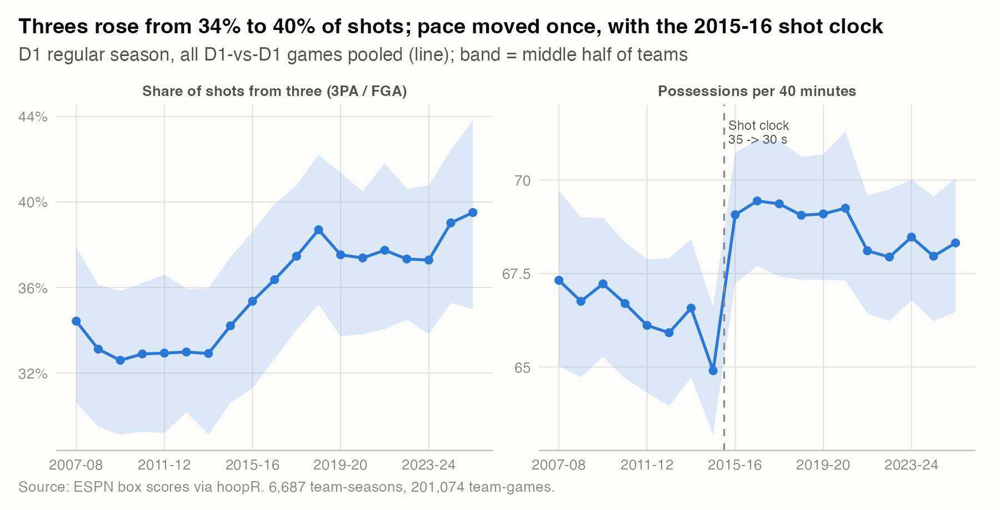
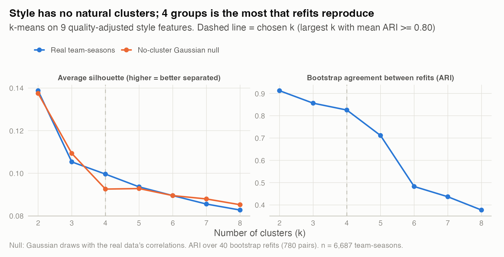
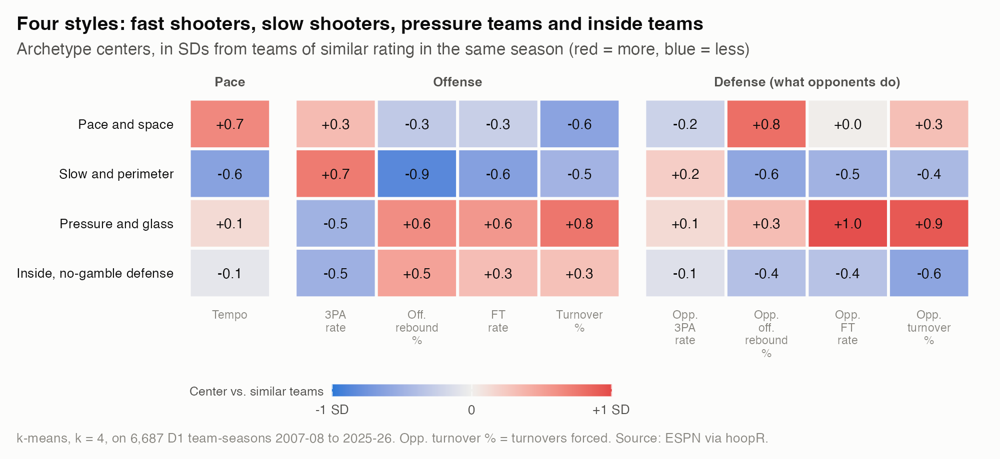
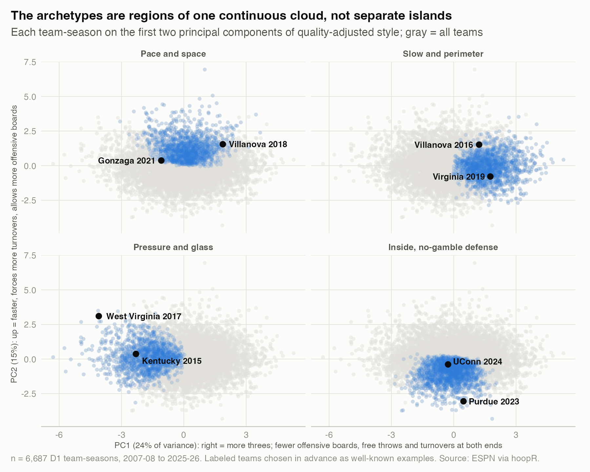
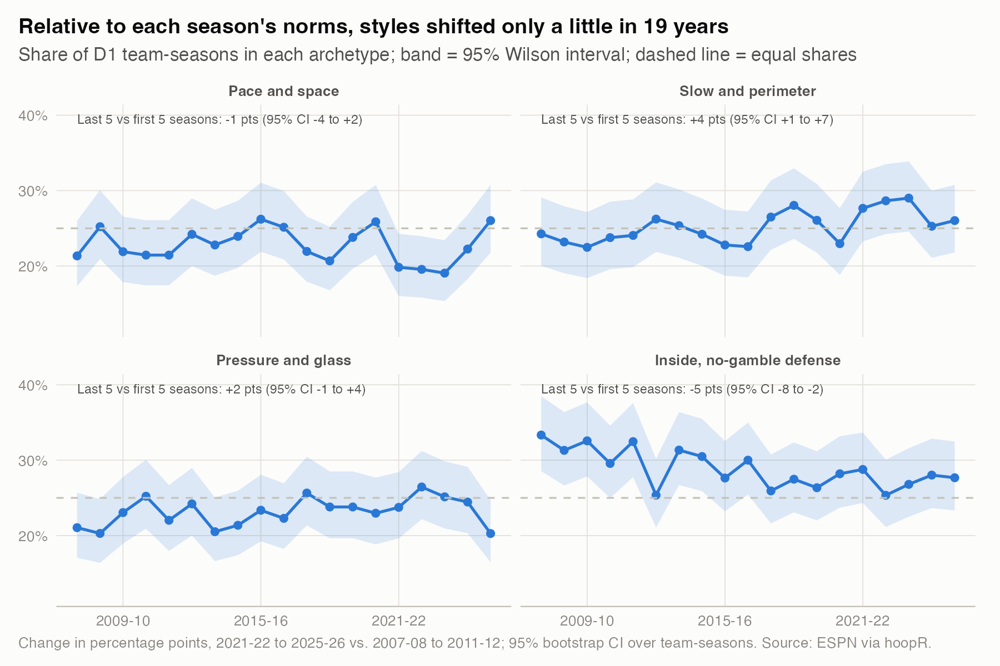
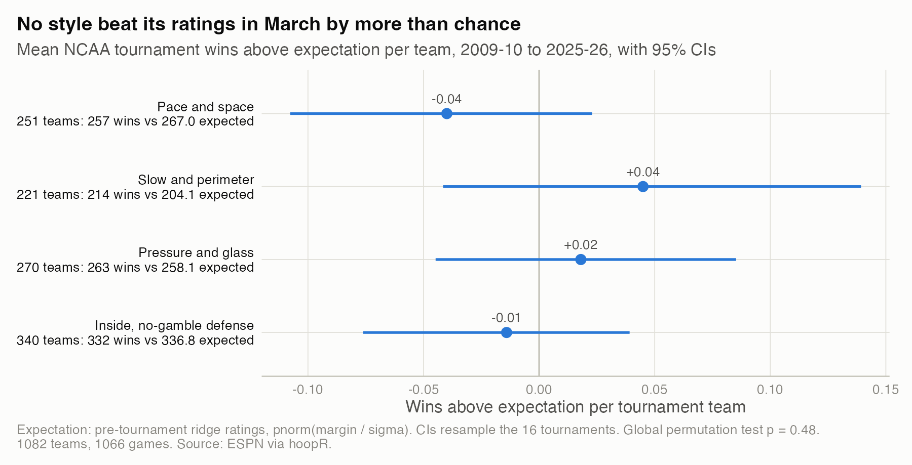

# 07. What kinds of teams are there, and does style matter in March?

**College teams do not fall into natural style clusters, but four reproducible archetypes describe them: pace and space, slow and perimeter, pressure and glass, and inside teams with a no-gamble defense. Once pre-tournament ratings are accounted for, no archetype won more or fewer NCAA tournament games than expected: archetype averages range from -0.04 to +0.04 wins per team, every 95% CI includes zero, and the pre-specified global test gives p = 0.48 (1,082 teams, 16 tournaments).**

| | |
|---|---|
| **Question** | Do teams sort into distinct playing styles, and does style predict March results beyond team quality? |
| **Data** | Public ESPN box scores via hoopR: 6,687 D1 team-seasons, 2007-08 to 2025-26 (201,074 regular-season team-games), and 1,066 NCAA tournament games, 2009-10 to 2025-26. No private data. |
| **Method** | Nine style features adjusted for team rating and standardized within season; k-means with k chosen by silhouette against a no-cluster null plus bootstrap stability; tournament wins above expectation from pre-tournament ridge ratings; pre-specified permutation test and tournament-level bootstrap. |
| **Skills shown** | Unsupervised learning (k-means, PCA), cluster validation (null reference, bootstrap stability with a hand-written adjusted Rand index), feature engineering, confounder adjustment, pre-specified hypothesis testing, permutation tests, cluster bootstrap, power analysis. |

## Why it matters
March upsets are often explained by style ("live and die by the three", "defense travels"). If style mattered beyond quality, a team-strength model would be missing something. The same discipline applies to any segmentation: check that segments are real and stable, and that they predict something the obvious variable does not.

## What I found

**1. The three-point boom is real; pace moved once, with a rule change.** Threes rose from 34% of shots in 2007-08 to 40% in 2025-26. Pace jumped once, from 64.9 to 69.1 possessions per 40 minutes, when the shot clock fell to 30 seconds in 2015-16. This drift is why every feature is standardized within its season: with one pooled standardization, the most three-heavy cluster holds 2% of teams in 2007-08 to 2011-12 and 54% in 2021-22 to 2025-26, so the clusters would be eras, not styles.



*How to read it: the line is the D1 average; the band holds the middle half of teams.* Numbers: `results/league_trends.csv`, `results/era_check.csv`.

**2. There are no natural clusters, but four groups are reproducible.** Each style feature was first regressed on team rating within season, so archetypes describe how a team plays, not how good it is (archetype explains 0.2% of rating variance, 11% without the adjustment). The average silhouette is at most 0.14 at every k and matches a Gaussian cloud with the same correlations (0.100 vs 0.093 at k = 4): there are no gaps between groups. Bootstrap refits agree up to k = 4 (mean adjusted Rand index 0.83), then fall apart (0.48 at k = 6). I used k = 4, the most groups refits reproduce. The archetypes are labels on a continuum, like "tall" and "short".



*How to read it: blue tracking orange means no more structure than random data.* Numbers: `results/k_selection.csv`.

**3. Four styles.**
- **Pace and space** (23% of team-seasons): fastest (69.6 possessions per 40 minutes), more threes, few turnovers, gives up offensive rebounds. Gonzaga 2021, Villanova 2018.
- **Slow and perimeter** (25%): slowest (66.0), most threes (40% of shots), skips the offensive glass, defense rarely fouls or gambles. Virginia 2019, Villanova 2016.
- **Pressure and glass** (23%): forces turnovers (+0.9 SD) and fouls (+1.0 SD), crashes the glass, gets to the line, turns it over. West Virginia 2017, Kentucky 2015.
- **Inside, no-gamble defense** (29%): few threes (33% of shots), more offensive rebounds, a defense that does not chase steals, foul or allow second chances. UConn 2024, Purdue 2023.



*How to read it: each cell is the archetype's center in standard deviations from teams of similar rating in the same season.* Numbers, with raw averages: `results/archetype_profiles.csv`.



*How to read it: each panel highlights one archetype on the same map of all team-seasons; the labeled teams were picked as well-known examples before plotting.* Every team-season's archetype and coordinates: `results/team_season_archetypes.csv`.

**4. The mix shifted a little.** Against each season's own norms, slow-and-perimeter teams gained 4 percentage points of share from the first five seasons to the last five (95% CI +1 to +7) and inside teams lost 5 (95% CI -8 to -2). The other two moved 2 points or less, CIs spanning zero.



*How to read it: the band is a 95% interval for each season's share.* Numbers: `results/archetype_share.csv`, `results/archetype_share_change.csv`.

**5. Style did not predict March results beyond ratings.** This comparison was fixed before any tournament result was computed. Each game's win probability is pnorm(margin / sigma) from ridge ratings fit on pre-tournament games; a team's wins above expectation sum (win - probability) over its tournament games.

| Archetype | Teams | Wins | Expected | Per team (95% CI) |
|---|---|---|---|---|
| Pace and space | 251 | 257 | 267.0 | -0.04 (-0.11 to +0.02) |
| Slow and perimeter | 221 | 214 | 204.1 | +0.04 (-0.04 to +0.14) |
| Pressure and glass | 270 | 263 | 258.1 | +0.02 (-0.04 to +0.09) |
| Inside, no-gamble defense | 340 | 332 | 336.8 | -0.01 (-0.08 to +0.04) |

The global permutation test gives p = 0.48. A true difference from the field of 0.08 to 0.13 wins per team would have been detected 80% of the time, so effects that large are unlikely; smaller ones cannot be ruled out. Tournament teams had similar quality in every archetype (mean pre-tournament rating 10.0 to 11.7). Inside teams produced 7 of 16 champions from 31% of the field, too few to test and not part of the plan.



*How to read it: a point right of zero means the archetype won more tournament games than its ratings predicted.* Numbers: `results/march_wae.csv`, `results/archetype_summary.csv`.

## How I checked it
- **Planned in advance.** Archetypes, k and the test were fixed on regular-season data only; the plan heads `analysis.R`. One rule came after looking: silhouette was weak at every k, so stability chose k. No tournament data was involved.
- **Robustness.** Every variant I ran (`results/march_robustness.csv`):

| Variant | Range of archetype means | Global p |
|---|---|---|
| Primary | -0.04 to +0.04 | 0.48 |
| Archetypes from raw (unadjusted) features | -0.03 to +0.04 | 0.53 |
| Sigma recalibrated, leave one tournament out | -0.03 to +0.04 | 0.58 |
| First Four games excluded | -0.03 to +0.05 | 0.61 |
| Wins above expectation adjusted for rating | -0.04 to +0.04 | 0.55 |

- **Calibration.** Tournament probabilities score Brier 0.191 with a probit slope of 0.85 (SE 0.08): the ratings are a little overconfident in March. Recalibrating out of sample did not change the answer (`results/march_calibration.csv`).
- **Cluster agreement.** Raw-feature clustering gives 84% of team-seasons the same archetype (adjusted Rand index 0.63).
- **No look-ahead.** Features and ratings use only games before each season's first tournament game.
- **What would have changed the conclusion:** a global p below 0.05 that held across variants, or an archetype CI excluding zero in every variant.

## Limitations
- Box scores have no shot locations, lineup size, zone-versus-man or tracking data, so "style" is coarser than a coach's vocabulary.
- 16 tournaments cannot detect effects much below 0.1 wins per team, or test specific style matchups without fishing.
- k-means weights the nine features equally and draws hard borders on a continuum.
- The quality adjustment is linear. 24 games were dropped because the teams' possession counts disagreed by more than 10, and ESPN's public file lacks two 2016-17 First Four games.

## What I'd do next
- Test one pre-specified variance hypothesis: do three-heavy teams have wider outcome spreads, which would help underdogs and hurt favorites?
- Fit style matchups (archetype A against B) with a shrinkage model rather than 16 raw cells.
- Add rim and mid-range shot rates from hoopR play-by-play.

## Reproduce
```bash
Rscript studies/07-team-archetypes/analysis.R     # from the repo root; public data, cached under data/
```
Public data only; no KenPom subscription needed. Runtime: about 1 to 2 minutes on a warm cache.
