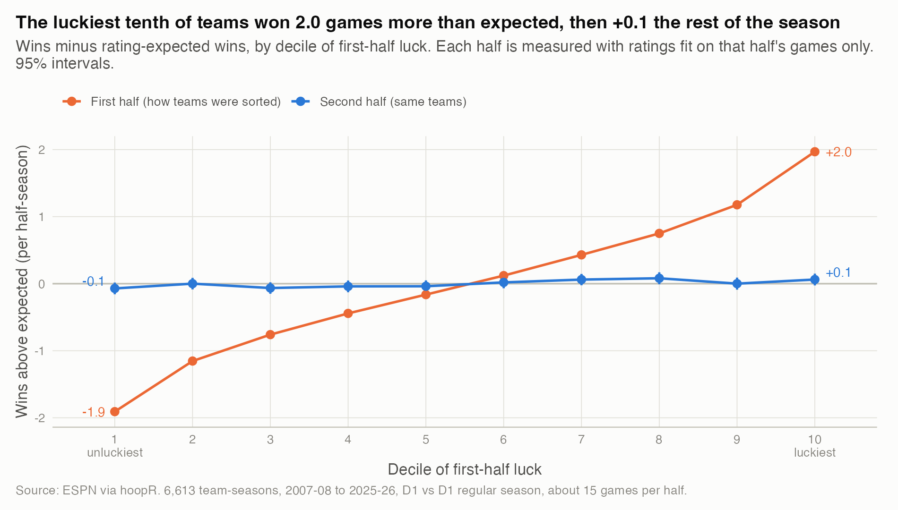
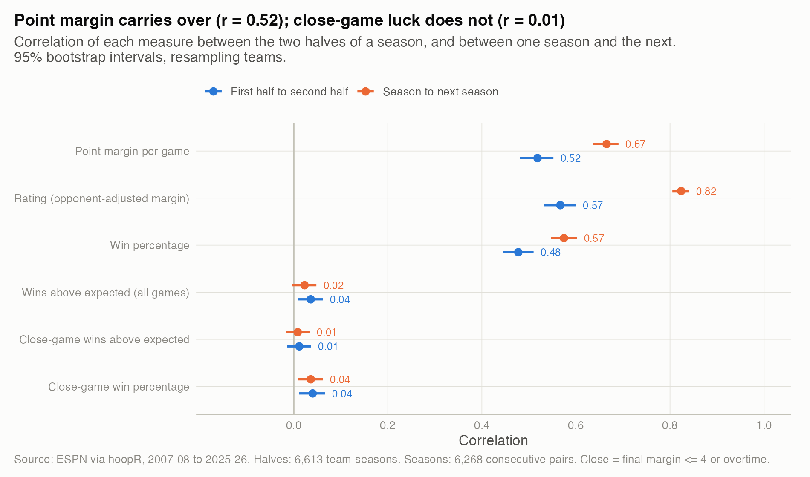
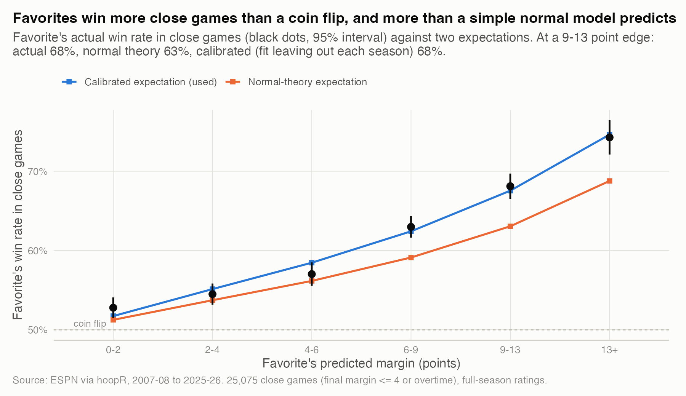

# 08. Is winning close games a skill?

**No, not in any amount I can measure.** A team's close-game record in the first half of a season has almost no relationship to its close-game record in the second half (r = 0.01, 95% CI -0.01 to 0.04), while its point margin carries over strongly (r = 0.52, 0.48 to 0.55). The luckiest tenth of teams won 2.0 more games than their ratings implied in the first half and 0.06 more in the second.

| | |
|---|---|
| **Question** | Do teams that win more close games than expected keep doing it? |
| **Data** | ESPN via hoopR (public). D1 vs D1 regular-season games, 2007-08 to 2025-26: 6,613 team-seasons split into halves, and 6,268 consecutive-season pairs. |
| **Method** | Ratings fit separately on each half-season; close-game wins compared with a calibrated expectation; correlations and regressions between halves and between seasons, bootstrapped by team. |
| **Skills shown** | Regression to the mean, signal-versus-noise decomposition, probability calibration, clustered bootstrap, pre-specified definitions with robustness checks. |

## Why it matters
Fans, coaches and media read a strong close-game record as poise or coaching. If it is mostly luck, those teams are weaker than their record, and anyone ranking or forecasting teams should trust point margin over wins.

## Definitions, fixed before looking
- **Close game:** final margin of 4 points or fewer, or overtime. That is 25% of games, about 3.8 per team per half. Margin of 3 or fewer and overtime-only are robustness checks.
- **Halves:** each season is split at its median game date. A ratings fit on each half uses only that half's games, so the two halves are measured independently.
- **Luck:** actual wins minus expected wins. In close games the expectation is conditional on the game being close: a 10-point favorite wins about 68% of close games, not 50% and not the 85% it would be before tip-off.

## What I found

**1. First-half luck almost completely disappears in the second half.**



*How to read it: teams are sorted by first-half luck (orange); the blue line shows the same teams afterward.* The top decile went from +1.97 wins above expected to +0.06 (SE 0.05), and the bottom decile from -1.91 to -0.07. About 3% of the luck carried over. Numbers are in `results/regression_to_mean_by_decile.csv`.

**2. Margin persists; close-game luck does not, within a season or across seasons.**



*How to read it: each dot is a correlation between two independent measurements of the same teams.* All numbers are in `results/persistence_correlations.csv`.

| Measure | Half to half | Season to next season |
|---|---|---|
| Point margin per game | 0.52 (0.48 to 0.55) | 0.67 (0.64 to 0.69) |
| Rating (opponent-adjusted) | 0.57 (0.53 to 0.60) | 0.82 (0.81 to 0.84) |
| Close-game wins above expected | 0.01 (-0.01 to 0.04) | 0.01 (-0.02 to 0.03) |
| Close-game win percentage | 0.04 (0.01 to 0.07) | 0.04 (0.01 to 0.06) |
| Wins above expected, all games | 0.04 (0.01 to 0.06) | 0.02 (-0.00 to 0.05) |

Raw close-game win percentage shows a faint correlation (0.04) only because better teams win more close games. Subtract the expectation and nothing distinguishable from zero is left.

**3. Close-game results are spread out exactly as much as weighted coin flips would be.**
If close games were decided by chance at the calibrated probabilities, a team's close-game wins above expected would have variance equal to the sum of p(1 - p) over its close games. Across 6,668 full team-seasons, the observed variance is 0.99 times that (95% CI 0.96 to 1.03). The 95% upper bound on a persistent close-game skill is a standard deviation of 0.23 wins per season, against 1.33 wins of pure luck. A second bound, from the half-to-half covariance, gives at most 0.36 wins. See `results/close_game_variance_vs_chance.csv`.

**4. First-half luck adds a sliver to second-half wins, but not to second-half luck.**
Regressing second-half win percentage on a forecast from first-half ratings plus first-half luck per game (season effects, SEs clustered by team): the forecast coefficient is 0.97 (SE 0.01) and luck is 0.078 (SE 0.025). For a top-decile team that is about 0.15 extra wins over the second half (95% CI 0.06 to 0.25). First-half close-game luck does not predict second-half close-game luck (0.011, SE 0.014). Year over year, luck predicts nothing: -0.056 (SE 0.036) for all games, -0.085 (SE 0.044) for close games. My reading: the small spillover is team-quality information that margins miss (garbage time, for example), not a knack for close games. Numbers are in `results/luck_regressions.csv` and `results/luck_regressions_year_over_year.csv`.

## How I checked it



*How to read it: black dots are what favorites actually did in close games; the lines are two ways of computing what they should have done.*

- **Calibration of the expectation.** My first expectation was textbook: assume the margin is normal around the predicted margin and condition on it landing in the close range. It under-predicted favorites by up to 5.5 percentage points (68% actual vs 63% at a 9-13 point edge), which would have handed good teams fake "luck". I replaced it with a logistic fit on the standardized predicted margin, one fit for all games and one for close games (regulation and overtime separately). Each season's expectation comes from a fit that leaves that season out. The calibrated version is within 1.5 percentage points of the actual rate in every bin (`results/close_game_calibration.csv`, `results/all_game_calibration.csv`). Every persistence result is also reported with the normal-theory expectation; the close-game correlation is 0.014 instead of 0.012.
- **Definitions.** Margin of 3 or fewer or OT: r = 0.01 (-0.02 to 0.03). Overtime only: r = 0.00 (-0.03 to 0.02). Dropping 2020-21: r = 0.01 (-0.01 to 0.04).
- **Look-ahead.** The second-half forecast uses first-half ratings only. Luck in each half uses that half's ratings, so neither half leaks into the other.
- **Uncertainty.** Correlations use 1,000 bootstrap resamples of teams, keeping all of a team's seasons together.
- **What would have changed the conclusion:** a half-to-half correlation of 0.10 or more for close-game luck, or an observed variance clearly above chance. Either would mean a real skill worth more than half a win a season.

## Limitations
- In-sample ratings absorb a little of each result, so the variance comparison is slightly conservative; the half-to-half bound does not have this problem.
- A skill smaller than about 0.2 to 0.4 wins a season cannot be ruled out with 19 seasons of data.
- "Close" is defined on the final score. Games that were close late but ended 6-8 points apart after intentional fouling are left out. Play-by-play data would allow a "within 5 points in the last 5 minutes" definition.

## What I'd do next
- Use play-by-play to define clutch possessions and test whether free-throw shooting or turnover rate late in games explains the small spillover in finding 4.
- Test for a coach-level close-game effect across long tenures, a larger sample per unit than a team-season.
- Feed "luck" into a preseason forecast as a regression-to-the-mean adjustment and measure the out-of-sample gain.

## Reproduce
```bash
Rscript studies/08-luck-and-regression-to-the-mean/analysis.R     # from the repo root; public data, cached under data/
```
Public data only; no KenPom or market data. Runtime: about 20 seconds from a warm cache.
