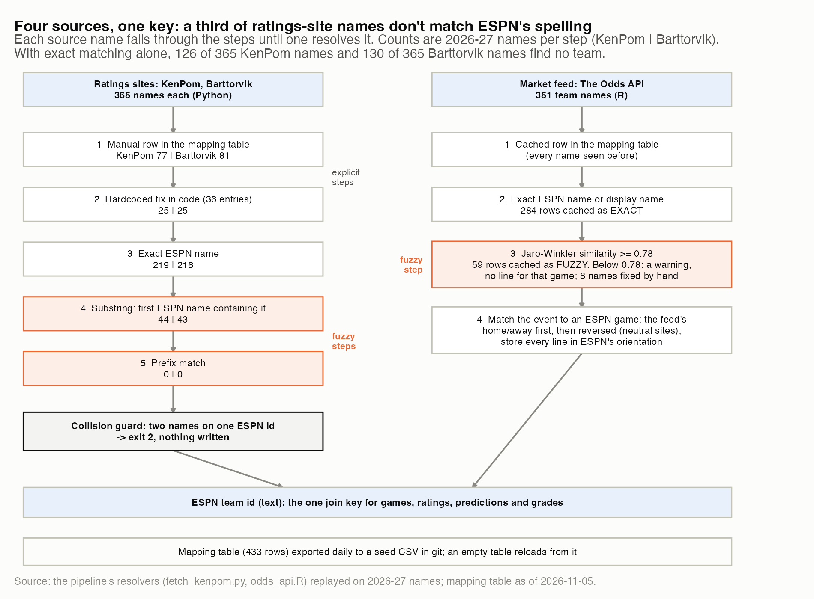
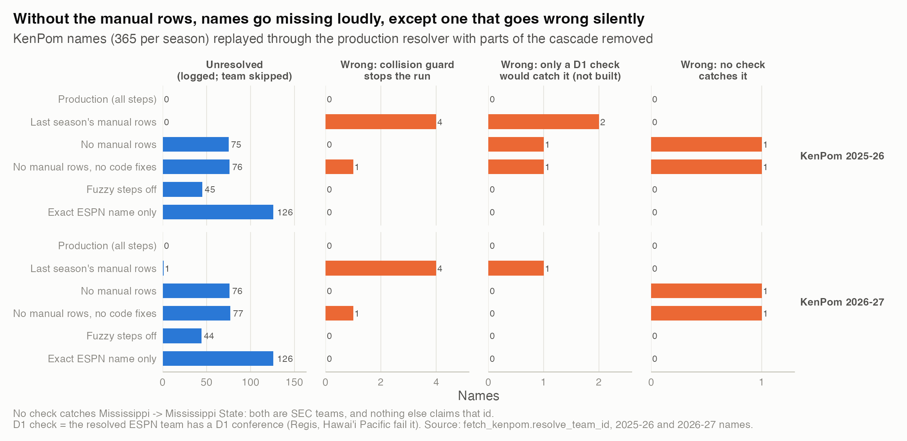
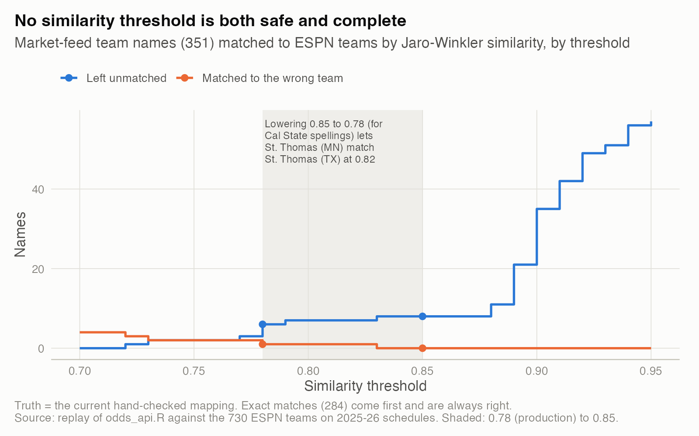
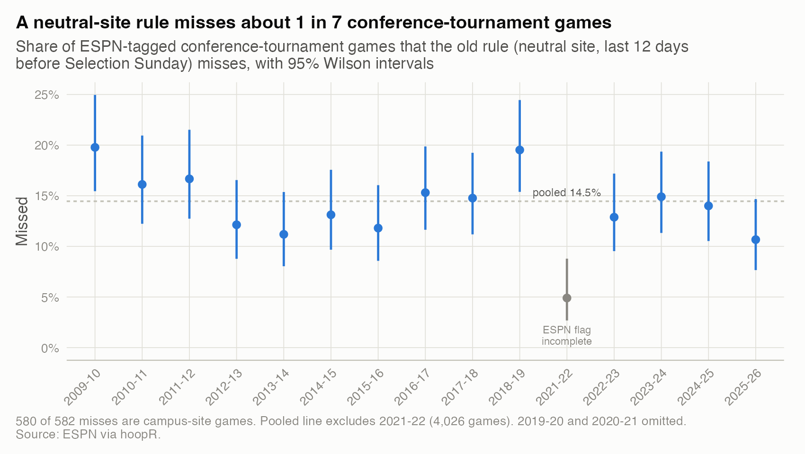

# 09. Entity resolution: making four sources agree on who is who

**The answer, in two sentences.** A third of the ratings sites' team names (126 of 365 KenPom names) don't match ESPN's spelling, and last season's hand-written fixes sent 6 teams' ratings to the wrong team or to a Division II school without raising an error. Replaying the production resolver shows that explicit mapping rows plus a hard stop on collisions now resolve all 365 names on all three lists, while the fuzzy steps still carry 44 names, 3 of them right only because of a table's row order.

| | |
|---|---|
| **Question** | When four sources name the same 365 teams differently, how often does the join go wrong, and which safeguards catch it? |
| **Data** | ESPN (hoopR) schedules and team ids; KenPom and Barttorvik team names (365 each, 2025-26 and 2026-27); 351 market-feed team names; the pipeline's 433-row mapping table. Names and counts only, no ratings. Conference-tournament part: public ESPN data, 15 seasons, 4,230 tagged games. |
| **Method** | Replay the production resolvers with parts removed (ablation), shuffle the team table 500 times, sweep the fuzzy-match threshold, and compare two conference-tournament detectors season by season. |
| **Skills shown** | Entity resolution, data quality engineering, ablation testing, SQL type semantics, defensive pipeline design. |

## Why it matters
Every number in the pipeline is joined on ESPN's team id. If "Montana St." resolves to Montana, Montana gets two sets of ratings, Montana State gets none, and every downstream report inherits the mistake without an error. Silent join errors are among the commonest and least visible ways a pipeline goes wrong.

## What I found

**1. Exact matching alone leaves a third of the names without a team.** A ratings-site name tries five steps in order: a manual mapping row, a hardcoded fix in code, an exact ESPN name, a substring match and a prefix match. The last two are fuzzy. In 2026-27 the 365 KenPom names resolve as 77 manual rows, 25 code fixes, 219 exact names and 44 substring matches. The market feed has its own path: a cached row, an exact name, then Jaro-Winkler similarity of at least 0.78. The mapping table is exported daily to a seed file in git, so a lost database doesn't lose the fixes.



*How to read it: each name falls down its lane until a step resolves it. Orange steps are fuzzy.* The numbers are in `results/cascade_steps.csv` and `results/mapping_composition.csv`.

**2. Last season's manual rows were wrong for 6 teams, and nothing failed.** The resolver code is unchanged from last season; only the manual rows differ. Replaying last season's rows on 2025-26 names gives 6 wrong teams:
- **4 collide with another team:** Cal Baptist resolves to UNC Wilmington, East Tennessee St. to East Carolina, Montana St. to Montana, and "Mississippi" (KenPom's name for Ole Miss) to Mississippi State.
- **2 land on Division II schools:** Sacramento St. resolves to Regis, and Hawaii to Hawai'i Pacific.

In the 2025-26 ratings table (11 KenPom dates kept), those six D1 teams have zero rows, and on 5 dates UNC Wilmington's id held Cal Baptist's numbers, because each insert silently replaced the previous row (`results/ratings_rows_2025_26.csv`). The new collision guard (exit 2, nothing written) stops 4 of the 6. The other 2 need a check the pipeline lacks: that the resolved team is D1.

**3. Without the manual rows, names go missing loudly, except one that goes wrong silently.** Without the manual rows, 76 of 365 names go unresolved and are logged. One goes wrong: Mississippi resolves to Mississippi State, both SEC teams, and nothing else claims that id, so no collision, D1 or conference check can catch it. Turning off only the fuzzy steps leaves 44 unresolved and none wrong.



*How to read it: each bar counts names under one version of the resolver. Orange bars are wrong teams.* The counts are in `results/ablation_summary.csv`, and every wrong name is in `results/ablation_errors.csv`.

**4. The fuzzy steps are right by luck of table order.** The substring step takes the first ESPN name containing the source name. For Seattle, Georgia Southern and Albany, a non-D1 school also matches (Seattle Pacific, Georgia Southern-East Georgia, Bryant & Stratton-Albany). Across 500 shuffles of the team table, 1.3 KenPom names resolved differently on average (90% of shuffles: 0 to 3). The answer also depends on which small schools are on a season's schedules: "Hawaii" resolves correctly against 2026-27 teams but to Hawai'i Pacific against 2025-26 teams (`results/order_sensitivity.csv`).

**5. No similarity threshold is both safe and complete.** I replayed the market-feed matcher against the 730 ESPN teams on 2025-26 schedules:

| Threshold | Correct | Wrong | Unmatched |
|---|---|---|---|
| 0.70 | 347 | 4 | 0 |
| 0.78 (production) | 344 | 1 | 6 |
| 0.85 | 343 | 0 | 8 |

The one wrong name at 0.78 is St. Thomas (MN), matched to St. Thomas (TX) at 0.82. The config says the threshold was lowered from 0.85 to catch Cal State spellings; that change is what lets St. Thomas through.



*How to read it: moving right trades wrong matches (orange) for missing ones (blue).* Results for both seasons' team lists are in `results/fuzzy_threshold_sweep.csv`.

**6. Two boundary bugs had the same shape: the join ran and matched nothing.**
- **Home and away.** On 2026-11-05 the feed listed 83 games. Two of the 4 at neutral sites had home and away reversed relative to ESPN, and the old matcher, trying one orientation only, gave them no market line. The fix retries reversed and stores every line in ESPN's orientation. In 2025-26 only 10 of 161 neutral-site games lacked a line on days the feed was pulled, so the flip cost at most 10 games (`results/orientation_2026_11_05.csv`).
- **Numbers vs text.** Two March reports guessed the ids were numbers when reading files. SQLite stores ids as text and compares the double 145 as "145.0", so every lookup matched nothing and every conference printed "Unknown". `results/type_contract_demo.csv` reproduces the bug:

| How the id reaches SQLite | SQLite compares | Rows matched |
|---|---|---|
| `read_csv()` default guess (double) | "145.0" | 0 |
| explicit `col_character()` | "145" | 1 |

**7. A neutral-site rule misses about 1 in 7 conference-tournament games.** The old rule called a conference game a tournament game if it was at a neutral site in the 12 days before Selection Sunday; ESPN tags these games directly. Over 14 seasons the old rule missed 582 of 4,026 tagged games, 14.5% (95% CI 13.4% to 15.6%), all but 2 at campus sites. In 2025-26 it missed 32 of 300 (10.7%, CI 7.7% to 14.7%), including 3 Big East games at Madison Square Garden that ESPN lists as St. John's home games.



*How to read it: each point is the share of tagged games the old rule missed that season.* The numbers are in `results/conf_tournament_detection.csv`.

## How I checked it
- **Production code, not a copy.** The ablation imports the pipeline's own `resolve_team_id` and changes only its inputs.
- **Checks on the reference answer.** On all three lists, the current mapping gives 365 distinct ids, all D1, all in the conference the source reports (`results/reference_checks.csv`).
- **Counts, not estimates.** Every name is counted, so there is no sampling error; the real variation is table order (the shuffle test) and each season's team list.
- **ESPN's tag is imperfect too.** In 2021-22 the old rule found 60 games that ESPN didn't tag, so that season is left out of the pool. The pipeline uses ESPN's tag and keeps the neutral-site rule as a fallback.
- **What would change the conclusion:** a wrong current row that passes all three checks, which the Mississippi case shows is possible.

## Limitations
- **The reference is the hand-checked current mapping.** A same-conference swap would pass every check, and nobody has audited all 365 rows by hand.
- **Last season's damage can't be fully measured.** Only 11 KenPom dates survive in the 2025-26 database.

## What I'd do next
- **~~Add a D1 guard to the ratings fetchers.~~ Done the same night.** Both fetchers now refuse to write if any name resolves to a team without a D1 conference, which, combined with the collision guard, would have caught all 6 of last season's errors. It has a unit test, and on the live 2026-27 data all 365 KenPom and 365 Barttorvik names pass. Next: log a conference mismatch as a warning.
- **Retire the substring step.** Write explicit rows for its 44 names, and let fuzzy matching only suggest rows for review.
- **Assert what caught these bugs.** Names matched must equal rows stored; that comparison is how last season's collisions were found. Ids must be read as text at every file boundary.

## Reproduce
```bash
Rscript studies/09-joining-four-data-sources/analysis.R     # from the repo root
```
- **Public parts** (the conference-tournament comparison and the type demo) run anywhere.
- **Private parts** need the pipeline at `NCAAB_PIPELINE_DIR` (mapping table, KenPom names: a subscription). They run `resolve_ablation.py`, which opens every database read-only and writes only names and counts. Without the pipeline, the committed `results/*.csv` are reused.
- **Runtime:** about 10 seconds.
