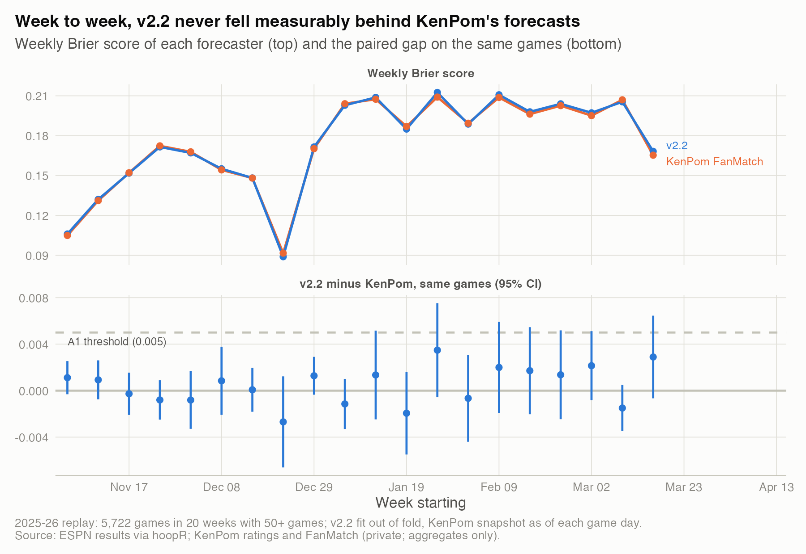
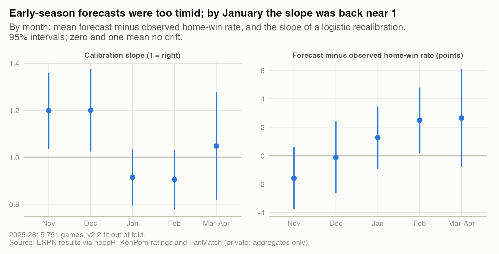
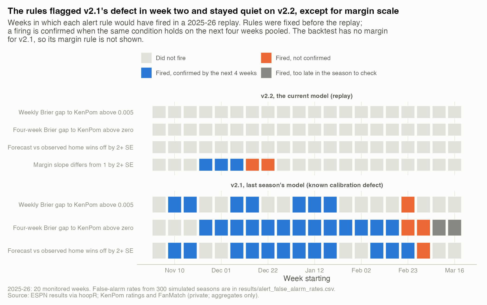
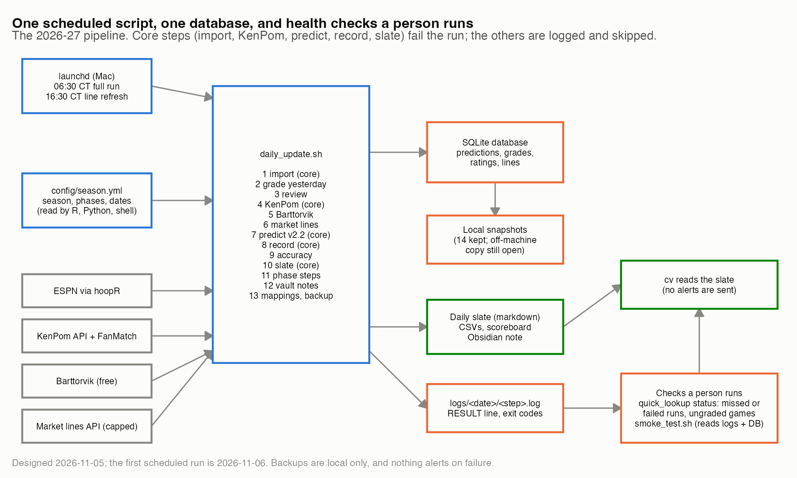

# 10. What monitoring would have caught

**Four simple alert rules, replayed on 2025-26, would have flagged last season's calibration defect in the second week of the season, about a year before an audit found it.** On the current model (v2.2) they stayed quiet except for one rule, which flagged the early-season margin scale in five weeks of November and December; the following weeks confirmed three of those five.

| | |
|---|---|
| **Question** | Which simple checks would have caught real problems in 2025-26, how often do they cry wolf, and how is the 2026-27 pipeline built to run them? |
| **Data** | 2025-26 no-look-ahead backtest: 5,751 D1 games, 20 weeks with 50+ games. ESPN results via hoopR; KenPom ratings and FanMatch (private; aggregates only). Pipeline code and docs for the design. |
| **Method** | Weekly replay of four alert rules fixed before looking; each firing checked on the next four weeks; false-alarm rates from 300 simulated seasons where nothing is wrong; last season's model as a positive control. |
| **Skills shown** | Model monitoring, drift detection, simulation-based false-alarm rates, pipeline design, failure-mode analysis. |

## Why it matters
Nobody reads calibration curves every morning. A monitoring rule earns its place only if it fires on real problems and stays quiet otherwise, and both can be measured before the season starts.

## What I found

**1. Week to week, v2.2 never fell measurably behind KenPom.** The weekly Brier gap between v2.2 and FanMatch ranged from -0.0027 to +0.0035, and no week's 95% interval sat entirely above or below zero.



*How to read it: the top panel shows how hard each week was; the bottom shows the paired gap, which is what a monitor should watch.* Numbers are in `results/weekly_monitoring.csv`.

**2. Early-season probabilities were too timid.** A logistic recalibration slope above 1 means forecasts should have been more extreme. v2.2's slope was 1.20 in November (95% CI 1.04 to 1.36) and 1.20 in December (1.02 to 1.38), then 0.92 and 0.91 in January and February. FanMatch shows the same pattern (1.13 and 1.15), so it comes from the early ratings, not from v2.2. Recalibrating did not help out of sample: fit on November and scored on December, Brier changed by +0.00001 (CI -0.0013 to +0.0014).



*How to read it: zero (left) and one (right) mean no drift.* Numbers are in `results/calibration_by_month.csv`, `results/calibration_slope_fanmatch_by_month.csv` and `results/recalibration_out_of_sample.csv`.

**3. The alert replay.** I fixed four rules before running the replay, from common practice rather than tuned to this season:

| Rule | Fires when | v2.2 firings | Confirmed | False alarms when nothing is wrong |
|---|---|---|---|---|
| A1 | Weekly Brier gap to FanMatch above 0.005, two weeks running | 0 | - | 0% of seasons |
| A2 | Four-week Brier gap to FanMatch above zero at 95% | 0 | - | 21% of seasons |
| A3 | Mean forecast vs observed home-win rate off by 2+ SE, two weeks running | 0 | - | 5% of seasons |
| A4 | Slope of actual on predicted margin off 1 by 2+ SE, two weeks running | 5 | 3 | 1% of seasons |



*How to read it: blue is a firing that the next four weeks confirmed; orange is one they did not.* Numbers are in `results/alert_replay.csv`, `results/alert_timeline.csv` and `results/alert_false_alarm_rates.csv`.

- **A4 found a real problem.** It first fired the week of November 24, after two straight weeks of large margins: the early-season scale that a retrospective study found on 2026-11-05 (study 02). The two December firings went unconfirmed because the next four weeks reached into January, when the slope fell below 1.
- **Positive control.** Run on v2.1, the rules fired early and often. A1 and A3 fired in the second week (November 10); A2 fired in 17 of 20 weeks. v2.1's mean forecast was below the observed home-win rate in 19 of 20 weeks, by up to 12 points (`results/alert_positive_control_summary.csv`).
- **A2 cries wolf.** Checked weekly at 95%, a significance rule fires falsely in about one season in five, simply from looking 17 times. It needs a stricter level or a sequential test before it goes live.
- **A1 is a tripwire, not a detector.** Its threshold is 2.4 to 7 times the weekly standard error of the gap, so it only catches large breaks like v2.1's.

**4. The production design.** The 2026-27 pipeline is one scheduled shell script that writes one SQLite database, with health checks a person runs.



*How to read it: arrows show data flow; core steps stop the run when they fail.* Components are listed in `results/architecture_components.csv` and `results/architecture_edges.csv`.

- **Schedule.** launchd starts `daily_update.sh` at 06:30 CT (full run) and 16:30 CT (line refresh), under `caffeinate` so a woken Mac does not sleep mid-run.
- **Steps and exit codes.** Each step logs to `logs/<date>/<step>.log`. Five core steps (import, KenPom, predict, record, slate) fail the run with exit 1; the rest are logged and listed. A guard that refuses on purpose (the market-data credit cap) exits 75 and is listed as skipped, not failed.
- **Single source of truth.** `config/season.yml` holds the season and phase dates; R, Python and the shell read it, and the smoke test checks they agree.
- **Health.** `quick_lookup status` reports each job's last result, a missed run, stale ungraded predictions and the scoreboard. `smoke_test.sh` checks the environment, code, unit tests and both data APIs without spending credits.

| Failure | How the design handles it | Still open |
|---|---|---|
| Mac asleep at run time | launchd runs the job at the next wake | A powered-off Mac misses the run; nothing alerts |
| Data source down or changed | Core step fails loudly; run exits 1 | Found only when someone checks status |
| Two team names map to one team | Rating fetch exits 2 and writes nothing | Needs a manual mapping |
| Results posted after the morning run | Graded on the next run | None |
| Line posted after the morning run | 16:30 refresh fills it for games not yet tipped | None |
| Postponed game | Not graded while the score is 0-0 | None |
| Database lost or corrupted | Snapshot after every run, 14 kept | Local only; off-machine copy not built |

## How I checked it
- **Rules fixed in advance.** I set the four rules and their thresholds before running the replay, and I report every rule, not only the one that fired.
- **Simulated false alarms.** For the skill rules, each game's gap got a random sign (equal skill). For calibration, outcomes were drawn from v2.2's own probabilities. For margin scale, residuals were centered and shuffled within each week.
- **A level error can pose as a scale error.** Refit with an intercept, A4 fires only once (the week of November 24): part of its signal was home teams beating the out-of-fold margin by 1 to 3 points early in the season (`results/alert_A4_with_intercept.csv`).

## Limitations
- This is a replay on one season. The live pipeline has a scoreboard (v2.2, last season's model, FanMatch and the market) but none of these rules run automatically yet.
- No reliability claims: the first scheduled run is 2026-11-06, backups are local only, and the Mac has died on battery before.
- "Confirmed" uses the next four weeks, which can cross a real change (as in late December).
- The v2.1 control is the backtest's rebuild of v2.1 on the same KenPom inputs, not last season's live predictions.

## What I'd do next
1. Add A3 and A4 to the daily accuracy report, and A2 with a sequential test.
2. Decide on alerting. The owner turned alerts off on purpose; if that changes, the cheapest useful one is a single message when a core step fails or a run is missed.
3. Copy the nightly database snapshot off the machine with credentials scoped to that one job.

## Reproduce
```bash
Rscript studies/10-running-a-model-in-production/analysis.R     # from the repo root
```
Needs the private pipeline (KenPom subscription) for the per-game forecasts; see `../02-judging-forecasts/forecast_tools.R`. The architecture figure needs no private data. Runtime: about 15 seconds.
