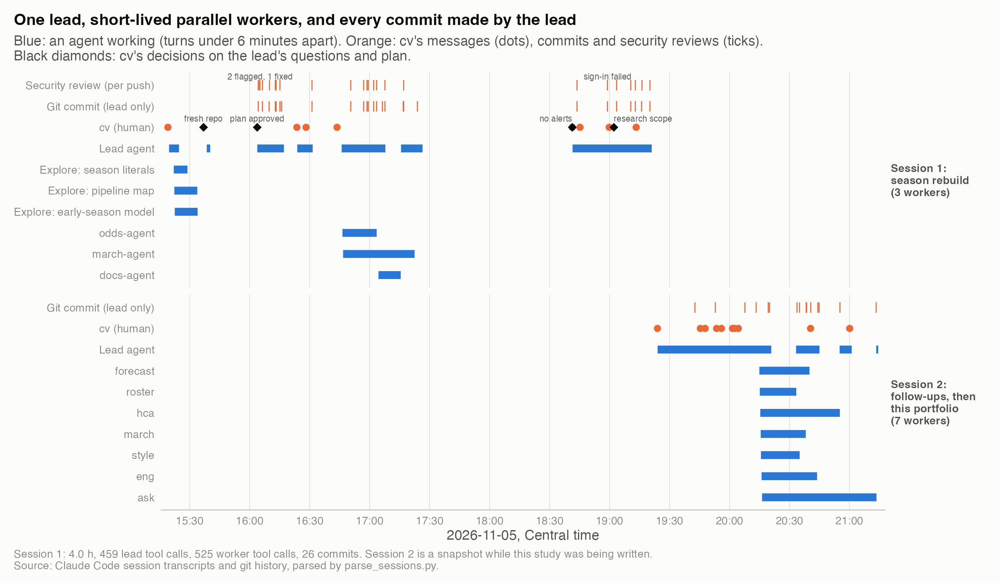
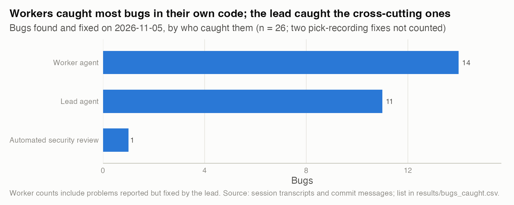

# 11. How I used parallel AI agents to rebuild a season pipeline in an afternoon, and kept them honest

**The answer, in two sentences.** In four hours on 2026-11-05, one lead agent and six helpers forked last season's prediction pipeline for 2026-27, repaired it and re-documented it. That meant 26 commits and 26 bugs found and fixed, 14 of them reported by the helpers. What kept the work honest was process rather than trust: written briefs with explicit file lists, no commits by helpers, claims checked against the database before each commit, a free health check run 25 times, and an automated security review on every push.

| | |
|---|---|
| **Question** | Can parallel AI agents do real pipeline work quickly without losing control of scope, quality or secrets? Which gates made that true? |
| **Data** | Claude Code session transcripts (JSONL) for the lead session and its 6 helper agents, 24 automated security-review sessions, and git history. A second session, the build of this portfolio with 7 helpers, is included in full. Only counts and timestamps are published. |
| **Method** | Parse every transcript for tool calls, timing, commits and edits. Check each helper's edits against its brief, and trace every bug to who caught it. |
| **Skills shown** | AI engineering (multi-agent orchestration), LLM guardrails and evaluation, software process design, security review, data engineering. |

## Why it matters
AI agents can write a lot of code in parallel. The hard part is knowing what they changed, whether it works and whether anything leaked. A team lead deciding whether to use agents needs to know which controls are cheap and which ones caught real problems.

## What I found

**1. The work came in short parallel bursts, and only the lead committed.** The lead started at 15:19 Central with the instruction from cv: fork the project for the new season and get it ready for that night's games.
- **Planning.** Three read-only Explore agents mapped the pipeline, audited season-specific values and checked the early-season model (7 to 11 minutes each). cv approved the plan 23 minutes after the lead proposed it.
- **Parallel work.** Three named workers ran at the same time:
  - `odds-agent` fixed neutral-site matching and moved the API client (17 minutes, 58 tool calls).
  - `march-agent` rebuilt the bracket code for the 76-team field (36 minutes, 153 tool calls).
  - `docs-agent` rewrote the docs and skills (11 minutes, 98 tool calls).
- **Lead commits.** Meanwhile the lead made 26 commits. Leaving out the first commit, which copied last season's code into the new repo, they add 11,796 lines and remove 6,935.



*How to read it: each row is an agent or an event stream. Blue bars are stretches of work; orange marks are cv's messages, commits and security reviews; diamonds are cv's decisions.* The data is in `results/timeline_events.csv`, `results/agent_roster.csv`, `results/commits.csv` and `results/human_decisions.csv`.

**2. Nine gates, each cheap, each with evidence it held.**

| Gate | How it works | Evidence |
|---|---|---|
| Written brief per worker | Goal, allowed files, forbidden actions, test plan, report format | 13 briefs of 2,202 to 5,329 characters. Session 2 adds one shared brief of 8,360 |
| File ownership | Each worker gets an explicit file list; the lead owns everything else | 0 of 123 Edit/Write calls by workers fell outside their list |
| Workers never commit | The lead checks each report against the database, then commits by path | 0 commits by workers |
| Read-only data, sandbox tests | Live and archive databases stay read-only; tests run on a copy | `march-agent` replayed all 67 games of 2026 and a synthetic 76-team bracket on a copy |
| Paid-API budget | Hard cap on live calls per worker | `odds-agent` used 1 of its 2 allowed calls (3 credits) |
| Cheap health check | `smoke_test.sh` checks config, database, mappings, seed files and tests, with no API credits | 25 runs in session 1 |
| Automated security review | An LLM reviewer reads each pushed diff, and a second pass tries to refute each finding | 23 reviews and 1 verification pass. 2 findings: 1 refuted, 1 fixed. 1 review failed to sign in |
| Manual fallback review | When the automated review couldn't run, the lead scanned history, logs and backups | No secrets found. 2 hardening fixes and 1 latent SQL bug |
| Human scope decisions | cv answers the lead's questions and approves the plan | 4 questions answered, the plan approved, alerts removed, scope set to research and tracking |

The full table is in `results/gates.csv`. Briefs did the most work. Each one named the files the worker could touch and what it must not do: commit, print a key, write to the live database, or spend more than two paid API calls. Each also said what proof to bring back. The workers stayed in bounds without exception, and their reports came back as test evidence rather than assurances. For example, `odds-agent` reported 18 offline checks, then one live run in which all 83 games matched, plus a spot check of both reversed games across all five price sources in the feed.

**3. Workers caught most bugs in their own code; the lead caught the cross-cutting ones.** Of the 26 bugs:
- **14 came from workers, inside the files they were given.** Examples:
  - Market consensus was skipped on any run after 6 PM because a UTC date was compared with local time.
  - The bracket import's ESPN lookup had matched 0 of 32 games the season before.
  - A hardcoded league average pulled projections about 4% low.
- **11 came from the lead, at the seams between parts.** The biggest was a mismatch between names matched and rows stored (364 vs 360), which exposed four wrong team-id mappings (study 09). Others: a type mismatch in the teams import, and a fatigue adjustment applied with its sign reversed.
- **1 came from the automated review.** An API key could reach the logs through an error message. The lead fixed it 55 seconds after the alert.



*How to read it: each bar counts bugs by who first caught them.* The full list is in `results/bugs_caught.csv`. Two fixes to pick-recording logic are left out because they don't fit this portfolio's scope.

**4. Humans decided scope, and the agents asked instead of assuming.** cv's decisions:
- The repo naming, and a fresh git history, so last season's history (which held a hardcoded credential) stayed out of the new repo.
- Plan approval before any code changed.
- Midway: no alerts, and no feed into another project. Both were removed and pushed within 3 minutes.
- At the end, after the lead asked what the project is for: research and tracking. Three unvalidated reports stay off rather than being rebuilt.

**5. The same pattern built this portfolio.** In session 2 the lead launched 7 workers in 82 seconds, each with a 2.4K to 4.4K character brief on top of one shared brief. The shared brief sets the rules on data licensing, betting language, statistics and charts. Each worker may write only inside its own study folder, may not commit or install anything, and must look at every figure it renders. The first worker finished 18 minutes after launch and the last, the LLM evaluation, after 57. Across the session the workers made 651 tool calls and no commits. The lead reviewed every study before committing it and changed four of them: pronouns in study 03, "picks" to "favored" in study 01, a statement in study 09 that a new guard had made stale, and the alerting next step in study 10. Review also caught one of the lead's own claims, in study 13, that a check against KenPom showed was wrong.

## How I checked it
- **Counts come from parsing, not memory.** `parse_sessions.py` reads every transcript line and counts tool calls, timestamps and `git commit` commands. Commit counts match `git log`, and the security-review outcomes are read from each reviewer's structured output.
- **Spot checks against the record.** Worker claims were checked against the workers' own transcripts and against git. For example, the files in the `odds-agent` commit are exactly the 5 its brief allowed.
- **No sampling error, and no counterfactual.** These are complete counts from one day, not estimates. The same work without agents was never attempted, so I make no speed-up claim.

## Limitations
- The ownership check sees Edit and Write calls only. Edits made through shell commands are covered only by the lead committing by path.
- The bug list is my classification of transcript text, and "who caught it" means who reported it first.
- The automated reviewer is an LLM. It refuted one of its own two findings, failed to sign in once, and recorded no reviews for session 2.
- One of the session-2 workers wrote this study; the lead reran it after every worker had finished.

## What I'd do next
- Log token cost per agent next to tool calls, to price each gate.
- Make the ownership check a pre-commit hook that compares staged files with the brief's list.
- Run one task twice, once solo and once with workers, to measure speed and defect rates.

## Reproduce
```bash
Rscript studies/11-built-with-ai-agents/analysis.R     # from the repo root
```
- **Inputs:** the transcripts in `~/.claude/projects` and both git repos. These are private; the parser publishes only counts and timestamps.
- **Without the transcripts:** the committed `results/*.csv` are reused and the figures are redrawn from them.
- **Runtime:** a few seconds.
