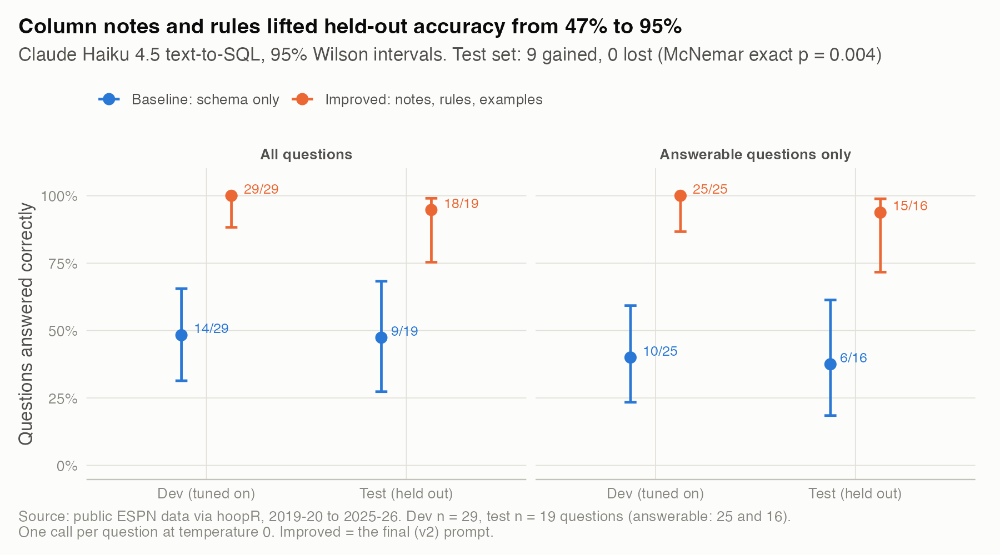
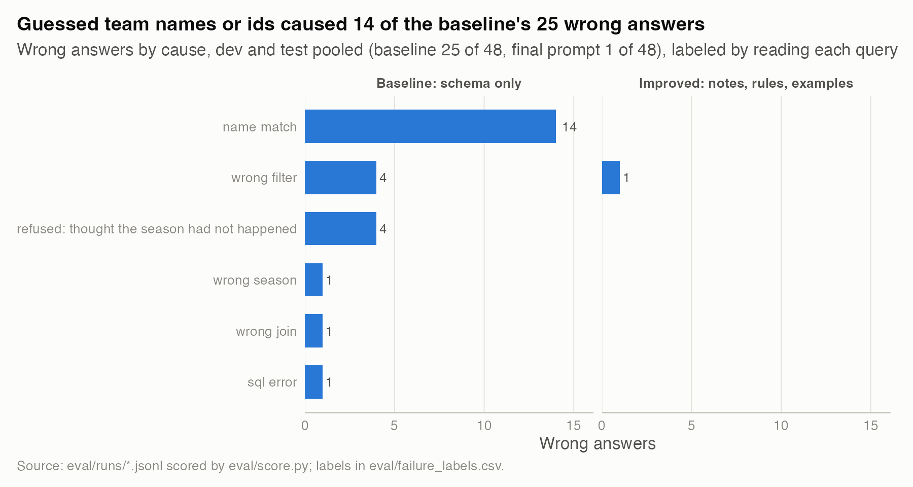

# 12. Ask a season of college basketball in plain English, and measure how often the answer is right

**With only the database schema, Claude Haiku 4.5 wrote SQL that returned the right answer for 9 of 19 held-out questions (47%, 95% CI 27% to 68%); with column notes, five rules and four worked examples, tuned on a separate dev set, it got 18 of 19 (95%, 75% to 99%).** That is 9 questions gained and none lost (gain 47 points, bootstrap CI 26 to 68; exact McNemar p = 0.004), at $0.0025 a question instead of $0.0009.

| | |
|---|---|
| **Question** | Can a small model answer plain-English questions about a basketball database correctly, and what does it take? |
| **Data** | ESPN via hoopR (public only), 2019-20 to 2025-26: 41,091 games, 82,098 team box scores, 2,507 team-seasons. 48 hand-written questions with gold SQL: 29 dev, 19 held-out test. |
| **Method** | A read-only stdio MCP server over SQLite; single-shot text-to-SQL on Amazon Bedrock at temperature 0; execution accuracy with Wilson intervals; paired exact McNemar test; hand-labeled failure taxonomy. |
| **Skills shown** | LLM evaluation, prompt engineering, MCP server design, SQL safety, data engineering, cost accounting. |

## Why it matters
Natural-language access to data is useful only if the numbers are right. A confident wrong answer is worse than "I can't answer that". This study builds the access layer and the measurement around it: a held-out question set, scoring by running the SQL, and a count of how the answers go wrong.

## What I built

**`season.db`**, from `build_db.R`. 18 MB, gitignored under `data/ask/`; no KenPom or odds.

| Table | Rows | One row per | Main columns |
|---|---|---|---|
| `seasons` | 7 | season | `season` (ending year), `label` ("2025-26"), `hca`, `sigma`, first and last date |
| `teams` | 1,132 | team in any game | `team_id` (ESPN), `name` (with mascot), `conference` (latest), first and last season |
| `games` | 41,091 | completed game | `date`, `game_type` (regular, conf_tournament, ncaa_tournament, other_postseason), `tourney_round`, home and away ids, names, scores, `margin`, `neutral`, `ot_periods`, `attendance` |
| `team_games` | 82,098 | team per game | `team_id`, `opp_id`, `win`, points, shooting, rebounds, turnovers, `poss` |
| `team_seasons` | 2,507 | Division I team-season | `conference`, record, conference record, `rating`, `rating_rank`, `tempo`, `off_eff`, `def_eff`, four factors for and against |

Two columns are derived. **Conference** comes from the schedule: connected components of each season's conference-game graph (31 or 32 a season), named from conference-tournament notes. **Rating** is the shared ridge fit on each season's regular-season Division I games, so it is an end-of-season rating. `schema_notes.md` documents every column, and the server serves that same file.

**`server.py`**, a stdio MCP server in about 400 lines of standard-library Python: JSON-RPC 2.0, one message per line, protocol 2025-06-18, with `initialize`, `notifications/initialized`, `ping`, `tools/list` and `tools/call`.

| Tool | Returns |
|---|---|
| `describe_schema` | The `CREATE TABLE` statements and the column notes |
| `run_sql(sql)` | One read-only SELECT, at most 200 rows, 5-second limit |
| `team_season(team, season)` | Record, rating and rank, efficiency, four factors |
| `compare_teams(team_a, team_b, season)` | Both teams side by side, head-to-head games, neutral-site rating gap |

The SQL guard has three layers, so no single one has to be perfect: a `mode=ro` connection; an authorizer that allows only SELECT, column reads and function calls (no PRAGMA, ATTACH, writes, temp tables or recursive CTEs; `load_extension` blocked by name); and a driver that refuses a second statement. A progress handler enforces the time limit, and SQLite limits cap any value at 1 MB.

Team names resolve conservatively: "Michigan" gives the Wolverines with Michigan State under `also_matched`, and "Loyola" gives three candidates and no answer.

`tests/test_server.py` has 23 tests. They drive the server as a subprocess (handshake, ping, `tools/list` shape, error codes, nothing but JSON-RPC on stdout) and send 23 hostile statements, among them DROP, ATTACH, VACUUM INTO, PRAGMA writes, `load_extension`, two statements in one string, and writes hidden behind a CTE or a comment. All are refused and the database file's hash is unchanged. Others cover the row cap, the timeout, a 2 GB `zeroblob` and the name matcher.

**Register it** (nothing on this machine was changed). Build the database first, then add this to Claude Desktop's `claude_desktop_config.json`, or put the same block in a project `.mcp.json` for Claude Code:

```json
{
  "mcpServers": {
    "ask-the-season": {
      "command": "python3",
      "args": ["/absolute/path/to/ncaab-analytics-case-studies/studies/12-ask-the-season/server.py"],
      "env": { "ASK_DB": "/absolute/path/to/ncaab-analytics-case-studies/data/ask/season.db" }
    }
  }
}
```

Or: `claude mcp add ask-the-season --env ASK_DB=/abs/path/season.db -- python3 /abs/path/server.py`. Any Python 3.11 or newer works.

## What I found

**1. Notes, rules and examples took held-out accuracy from 47% to 95%.**



*How to read it: each dot is the share of questions answered correctly, with its 95% interval; dev is where the prompt was tuned, test was run once at the end.* The baseline prompt was the schema plus the output format, including the CANNOT_ANSWER token. The improved prompt adds the column notes, five rules and four worked examples, none of them copies of an eval question. Both prompts handled all 7 unanswerable questions correctly (a refusal, or an empty result where the question allows one), so the whole gain is on answerable ones: 6 of 16 on test became 15 of 16 (gain 56 points, CI 31 to 81). The one remaining miss counted only champions listed as the home team, which drops Baylor (2020-21) and Florida (2024-25). See `results/fig01_accuracy.csv` and `results/mcnemar.csv`.

**2. The baseline mostly failed on names, not SQL.**



*How to read it: wrong answers by cause, from reading each failing query.* 14 of the baseline's 25 wrong answers guessed a team: `team_id = 'gonzaga'` when ids are numbers, or `name = 'Duke'` when names end in the mascot. Four used the wrong filter: two counted NIT games as NCAA tournament games (`season_type = 3`), and two used values that do not exist (`season_type = 1`, `tourney_round = '1'`). Only one was a SQL error. See `results/fig02_failures.csv`.

**3. The model thought 2025-26 had not happened yet.** Four baseline refusals said the season "is in the future" and refused questions the data answers. The model's sense of today leaked into a database task. The improved prompt opens by stating the seasons covered, and it answered all four. A related slip survived the first improved prompt: twice on dev it picked the wrong season, once reading "2023-24" as season 2023. Version 2 added an explicit conversion rule and comments in the examples, and dev went from 27 of 29 to 29 of 29.

**4. The better prompt costs 2.8 times as much per question, and 1.4 times as much per right answer.**

| Test set, 19 questions | Baseline | Improved |
|---|---|---|
| Input tokens per question | 574 | 2,134 |
| Output tokens per question | 67 | 74 |
| Cost per question | $0.00091 | $0.00250 |
| Cost per correct answer | $0.00192 | $0.00264 |
| Median latency (max) | 0.88 s (2.1 s) | 0.93 s (4.8 s) |

Prices: Haiku 4.5 through Bedrock's global cross-Region profile, $1.00 per million input tokens and $5.00 per million output (Bedrock pricing, checked through a secondary source, November 2026). Latency is Bedrock's own `latencyMs`. The improved prompt, about 2,100 tokens, sits below the 4,096-token minimum Haiku 4.5 needs for prompt caching, so caching could not lower it.

**Total Bedrock spend for the study: $0.28** (222,354 input and 11,506 output tokens over 140 billed calls, against a hard budget of $1.00). The ledger in `eval/runs/` matches CloudWatch's token counts exactly. It includes 14 calls whose outputs were lost when one batch hit the sandbox time limit, logged in `eval/runs/_lost.jsonl`, and a one-call connectivity probe.

## How I checked it
- **The split came first.** I wrote all 48 questions and gold queries, drew a stratified split once (seed 20261105) and froze it, fingerprint `9e527b5f`, before any model saw a question. Test ran once per prompt, after the final prompt was chosen on dev by a rule fixed in advance: v2 unless it scored below v1. (One improved test batch timed out before returning anything; it was rerun, and its outputs were never seen.)
- **The scorer was checked against the gold.** `score.py --selftest` must score the gold queries 48 of 48 and checks the statistics code against hand values.
- **Matching rules were fixed before scoring.** Rows compare as multisets unless order is asked for, extra predicted columns are allowed, integers match exactly, and other numbers match within display rounding. The query is the reply's last code block, because Haiku sometimes revises itself mid-answer.
- **One gold changed after the first dev run.** T04, "UConn's record before January 1, 2024", reads two ways, so the literal reading is also accepted. No answer matched either reading then, so no score moved.
- **Every batch is checked against the prompt file** by a fingerprint the sandbox returns. All raw outputs are saved, and `analysis.R` re-scores them offline.

## Limitations
- **Small test set.** With 19 questions the intervals are about 40 points wide. The paired test settles the direction, not the size.
- **I had seen the test questions when I wrote the notes.** I kept the notes to general documentation, and each v1 to v2 change came from a dev failure. The unanswerable test questions ask for data that rule 5 names, but the baseline already refused all of them.
- **One call per question at temperature 0.** I did not measure run-to-run variation.
- **Single-shot, not agentic.** Through the MCP server a model can read an error and retry, which this eval does not measure. The name matcher is unit-tested, not evaluated by the model.

## What I'd do next
- Evaluate the agent loop: Claude with the four tools, scored on the same questions, to see what retries recover.
- Grow the test set to 100 or more, with questions written by someone who has not seen the schema notes.
- Compare models and check stability with three trials per question.

## Reproduce
```bash
Rscript studies/12-ask-the-season/build_db.R                    # data/ask/season.db from the warm cache, ~5 s
python3 -m unittest discover -s studies/12-ask-the-season/tests  # server tests, offline
python3 studies/12-ask-the-season/eval/score.py --selftest       # gold SQL through the scorer: 48/48
ASK_PYTHON=python3 Rscript studies/12-ask-the-season/analysis.R  # rebuild, re-score saved outputs, draw figures, ~5 s
```
Public data only; nothing needs a KenPom subscription or an API key. New model runs go through `eval/harness.py`: `batch` writes a script for a sandbox that can reach Bedrock, and `ingest` checks and saves what it returns. The prompts are in `eval/prompts/` (`baseline.txt`, `improved.txt` for v1, `improved_v2.txt` final), the questions in `eval/questions.jsonl`, the failure labels in `eval/failure_labels.csv`.
