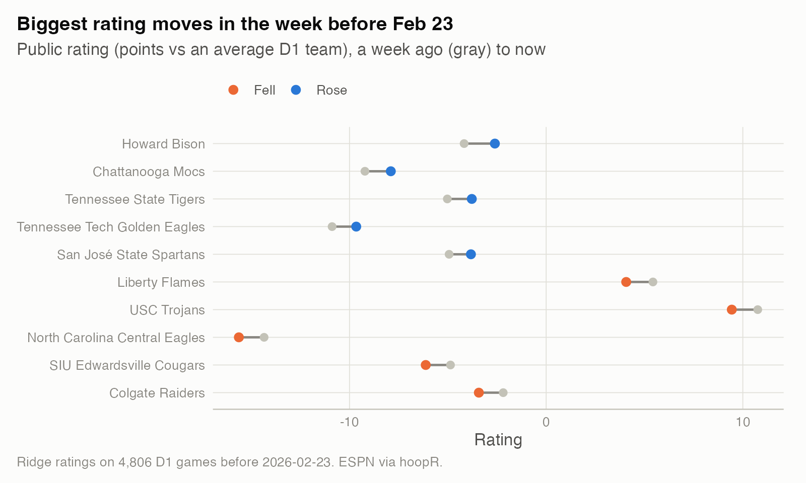
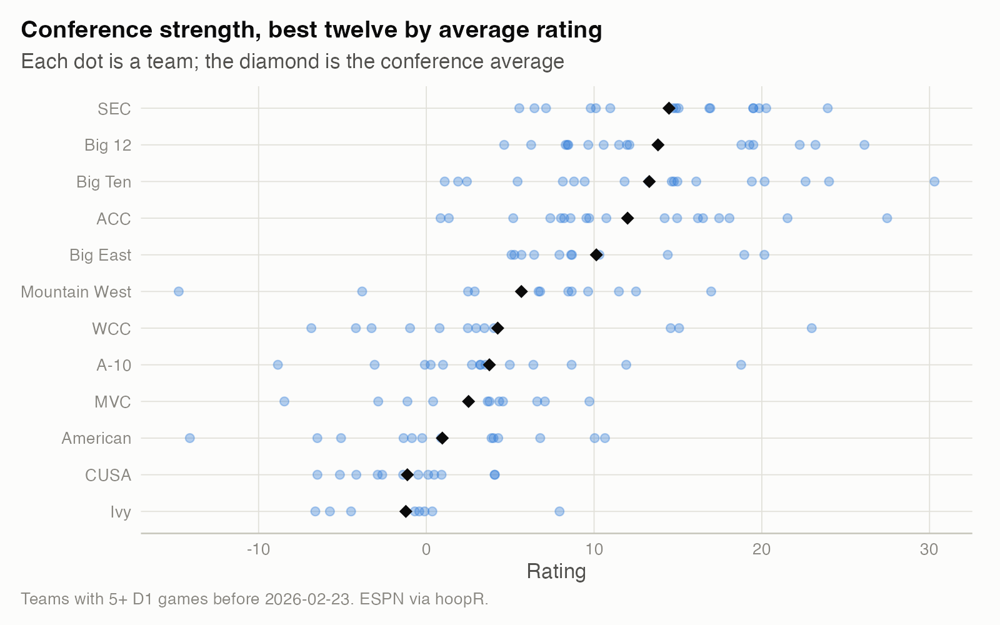

# 13. A weekly "state of the season" report, built from public data

**One script turns a season's box scores into a dated report that a non-specialist can read in two minutes: a top 25 with week-over-week movement, the biggest movers, efficiency and pace leaders, who has been lucky, and how the conferences stack up.** It runs on any date of any season since 2002-03, and it runs every Monday on the live 2026-27 season.

| | |
|---|---|
| **Question** | What would a useful, honest weekly briefing on a college basketball season look like if it used only public data? |
| **Data** | ESPN via hoopR: schedules and team box scores for the season, up to the report date. The sample is 2025-26 as of Feb 23, 2026: 5,354 games, 4,806 between D1 teams. |
| **Method** | Ridge least-squares ratings fit on every D1 margin before the report date; the same fit a week earlier for movement; win probabilities from the rating gap and the residual spread; raw efficiency from possessions. |
| **Skills shown** | Automated reporting, metric design, stakeholder communication, defensive engineering (early-season guards, atomic caching), reproducibility. |

**Sample:** [`sample/STATE_OF_THE_SEASON_2026-02-23.md`](sample/STATE_OF_THE_SEASON_2026-02-23.md)

## Why it matters
Most analytics work ends as a recurring report that someone reads on Monday morning. The hard parts aren't the model. They are choosing the few numbers worth a reader's attention, saying what each one means in one line, and making the report fail safely when the data isn't ready. This study is that, end to end.

## What's in the report
1. **Top 25 by rating**, with the week's change in rating points and in rank, record, and strength of schedule (the average rating of D1 opponents played). As of Feb 23, 2026, Michigan led at +30.3 points per game against an average D1 team on a neutral floor, ahead of Duke (+27.5) and Arizona (+26.1).
2. **Movers.** The five biggest risers and fallers over the week, as a before-and-after chart.

   

3. **Efficiency and pace.** Points scored and allowed per 100 possessions, not adjusted for opponents (the rating is), plus the fastest and slowest teams and their share of shots from three.
4. **Luck.** Wins minus the wins the ratings expected, game by game. In the sample, Liberty was 4.1 wins ahead of expectation, mostly from a 6-1 record in games decided by four points or fewer. Study 08 shows why that kind of record rarely holds up.
5. **Conference strength.** The average and spread of team ratings for the twelve strongest conferences.

   

The figures' numbers are in `results/teams_2026-02-23.csv` and `results/conferences_2026-02-23.csv`.

## Design choices
- **Public data only.** The live pipeline uses licensed ratings and market data. This report doesn't, so it can be published and anyone can rerun it.
- **One rating, explained in one sentence.** "Points better than an average D1 team on a neutral floor" is something a reader can use. It also lands close to the established systems. Fit on the full 2025-26 regular season, its top five (Michigan, Duke, Arizona, Florida, Iowa State) shares four teams with KenPom's top five on Selection Sunday; KenPom had Houston fifth and Iowa State sixth.
- **Movement against a fixed reference.** Week-over-week change uses a fit that stops seven days earlier, so a team's move reflects that week's games plus how its earlier opponents' ratings changed.
- **No predictions and no betting content.** The report describes the season so far.

## How I checked it
- **Ratings:** the fitting function has a test that recovers known ratings and home-court advantage from simulated games (correlation above 0.98, HCA within 0.3 points). It also checks that non-D1 opponents never receive a rating.
- **Early season:** the report refuses to run (exit code 75, which the scheduler records as a skip) until at least 100 teams have five D1 games. In 2025-26 that point arrived in late November. Before it, ratings rest on one or two games and the tables would mislead.
- **Robust solver:** with few games, or when every game so far is at a neutral site, the least-squares system can be singular. A negligible penalty on the home-court term keeps it solvable. This was found by running the report on the second Monday of the 2026-27 season.
- **Caching:** downloads are cached per season. Rebuilds of the season in progress are written to a temporary file and renamed, so a reader in another process never sees half a file.

## Limitations
- Margin-based ratings don't know about injuries, lineup changes or garbage time. A 30-point blowout counts in full, unless you set the `cap` option.
- Efficiency numbers are raw. A team with a soft schedule looks better on them than it is, which is why the rating, not efficiency, sets the order of the top 25.
- Conferences come from ESPN's grouping of each team's conference games. Teams in their first D1 season can lack one.

## What I'd do next
- Add a preseason prior from last season's rating and roster continuity (study 03), so the report is useful from the first week.
- Publish it as a small static site that rebuilds each Monday.
- Add an "ask the report" box using the MCP server from study 12.

## Reproduce
```bash
Rscript studies/13-weekly-state-of-the-season/report.R --season 2026 --asof 2026-02-23   # the committed sample
Rscript studies/13-weekly-state-of-the-season/report.R --season 2027 --asof 2026-12-07 --refresh --out /tmp/state.md
```
Public data only. The first run downloads the season (about a minute); later runs take a few seconds.
