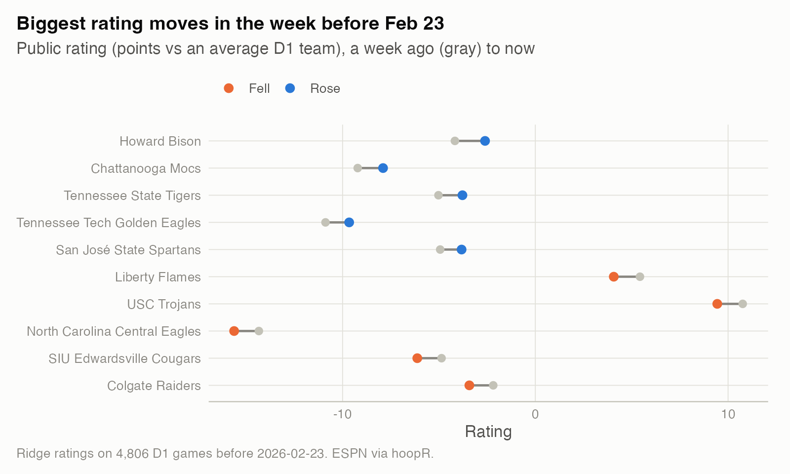
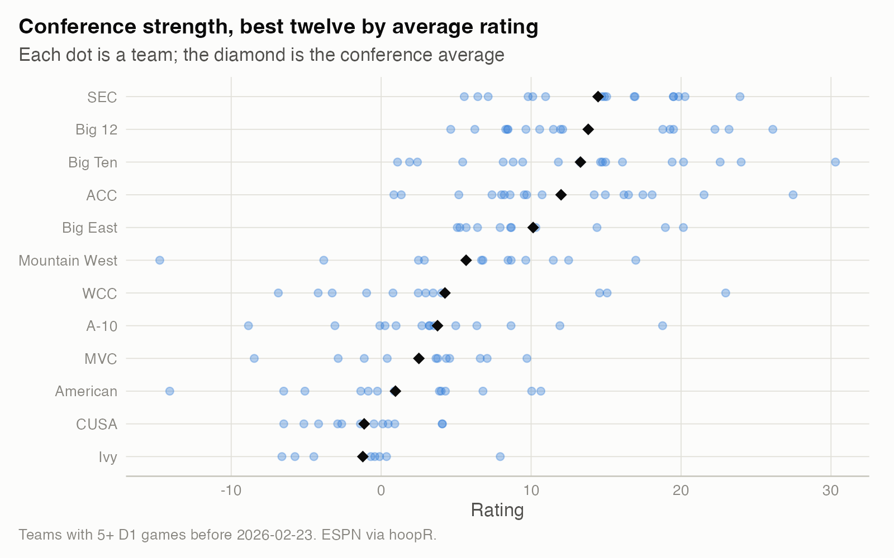

# State of the season: 2025-26, week of February 23, 2026

Public data only (ESPN via hoopR): 5,354 games before Feb 23, 4,806 of them between D1 teams. Ratings are points better than an average D1 team on a neutral floor, from a ridge least-squares fit of every D1 margin so far. Home-court advantage this season: **2.9 points**; a typical game's margin misses the ratings by 10.4 points (residual SD).

## Top 25

Week = change in rating points (and in rank) since a week ago. SOS = average rating of D1 opponents played.

| Rank | Team | Conf | Record | Rating | Week | SOS |
|---|---|---|---|---|---|---|
| 1 | Michigan Wolverines | Big Ten | 25-2 | 30.3 | -0.2 (0) | 11.0 |
| 2 | Duke Blue Devils | ACC | 25-2 | 27.5 | +0.9 (0) | 9.7 |
| 3 | Arizona Wildcats | Big 12 | 25-2 | 26.1 | +0.2 (0) | 9.1 |
| 4 | Illinois Fighting Illini | Big Ten | 22-6 | 24.0 | +0.6 (+2) | 9.4 |
| 5 | Florida Gators | SEC | 21-6 | 23.9 | 0.0 (-1) | 10.2 |
| 6 | Iowa State Cyclones | Big 12 | 23-4 | 23.2 | -0.7 (-1) | 6.9 |
| 7 | Gonzaga Bulldogs | WCC | 27-2 | 23.0 | -0.2 (0) | 4.2 |
| 8 | Purdue Boilermakers | Big Ten | 22-5 | 22.6 | +0.3 (+1) | 10.4 |
| 9 | Houston Cougars | Big 12 | 23-4 | 22.3 | -0.1 (-1) | 8.5 |
| 10 | Louisville Cardinals | ACC | 20-7 | 21.5 | -0.7 (0) | 8.2 |
| 11 | Vanderbilt Commodores | SEC | 21-6 | 20.3 | -0.6 (0) | 8.1 |
| 12 | Michigan State Spartans | Big Ten | 22-5 | 20.2 | +0.3 (+2) | 9.6 |
| 13 | UConn Huskies | Big East | 25-3 | 20.2 | -0.5 (-1) | 8.2 |
| 14 | Arkansas Razorbacks | SEC | 20-7 | 19.8 | -0.1 (-1) | 9.9 |
| 15 | Texas Tech Red Raiders | Big 12 | 20-7 | 19.5 | 0.0 (+1) | 11.1 |
| 16 | Alabama Crimson Tide | SEC | 20-7 | 19.5 | +0.1 (+2) | 12.0 |
| 17 | Tennessee Volunteers | SEC | 20-7 | 19.5 | +0.7 (+3) | 9.1 |
| 18 | Nebraska Cornhuskers | Big Ten | 23-4 | 19.4 | 0.0 (-1) | 7.9 |
| 19 | BYU Cougars | Big 12 | 20-7 | 19.3 | +0.5 (+2) | 9.7 |
| 20 | St. John's Red Storm | Big East | 22-5 | 19.0 | +0.3 (+2) | 7.8 |
| 21 | Kansas Jayhawks | Big 12 | 20-7 | 18.8 | -0.9 (-6) | 11.6 |
| 22 | Saint Louis Billikens | A-10 | 25-2 | 18.8 | -0.5 (-3) | 0.7 |
| 23 | Virginia Cavaliers | ACC | 24-3 | 18.1 | +0.3 (0) | 5.2 |
| 24 | NC State Wolfpack | ACC | 19-8 | 17.5 | +0.5 (+2) | 7.8 |
| 25 | Utah State Aggies | Mountain West | 23-4 | 17.0 | +0.1 (+2) | 4.4 |

## Movers this week

| Team | Conf | A week ago | Now | Change |
|---|---|---|---|---|
| Howard Bison | MEAC | -4.2 | -2.6 | +1.6 |
| Chattanooga Mocs | SoCon | -9.2 | -7.9 | +1.3 |
| Tennessee State Tigers | OVC | -5.0 | -3.8 | +1.2 |
| Tennessee Tech Golden Eagles | OVC | -10.9 | -9.7 | +1.2 |
| San José State Spartans | Mountain West | -4.9 | -3.8 | +1.1 |
| Liberty Flames | CUSA | 5.4 | 4.1 | -1.4 |
| USC Trojans | Big Ten | 10.8 | 9.4 | -1.3 |
| North Carolina Central Eagles | MEAC | -14.3 | -15.6 | -1.3 |
| SIU Edwardsville Cougars | OVC | -4.9 | -6.1 | -1.3 |
| Colgate Raiders | Patriot | -2.2 | -3.4 | -1.2 |

## Efficiency and pace

Points per 100 possessions, not adjusted for opponents (the rating is). Tempo is possessions per game.

| Best offense | Pts/100 |
|---|---|
| Illinois Fighting Illini | 126.6 |
| Miami (OH) RedHawks | 126.0 |
| High Point Panthers | 125.8 |
| Purdue Boilermakers | 124.5 |
| Akron Zips | 123.9 |

| Best defense | Allowed/100 |
|---|---|
| Saint Louis Billikens | 92.8 |
| Gonzaga Bulldogs | 92.9 |
| Duke Blue Devils | 93.1 |
| UT Martin Skyhawks | 93.5 |
| Arizona Wildcats | 93.9 |

| Pace | Team | Tempo | 3PA share |
|---|---|---|---|
| Fastest | IU Indianapolis Jaguars | 76.6 | 43% |
| Fastest | Cal Poly Mustangs | 76.5 | 53% |
| Fastest | Cal State Fullerton Titans | 76.3 | 42% |
| Slowest | Niagara Purple Eagles | 63.3 | 40% |
| Slowest | Louisiana Ragin' Cajuns | 63.5 | 42% |
| Slowest | Iowa Hawkeyes | 63.7 | 41% |

## Luck

Wins minus the wins the ratings expected from each game. Close-game records (4 points or fewer, or overtime) drive most of it, and they rarely persist (study 08).

|   | Team | Record | Wins vs expected | Close games |
|---|---|---|---|---|
| Luckiest | Liberty Flames | 23-4 | +4.1 | 6-1 |
| Luckiest | Miami (OH) RedHawks | 27-0 | +3.9 | 6-0 |
| Luckiest | UCF Knights | 19-7 | +3.8 | 5-0 |
| Luckiest | NJIT Highlanders | 15-14 | +3.7 | 3-1 |
| Luckiest | Tulane Green Wave | 17-10 | +3.6 | 7-1 |
| Least lucky | George Washington Revolutionaries | 15-12 | -4.1 | 1-4 |
| Least lucky | South Dakota State Jackrabbits | 13-16 | -3.4 | 1-4 |
| Least lucky | Youngstown State Penguins | 15-14 | -2.9 | 2-6 |
| Least lucky | Southern Indiana Screaming Eagles | 7-21 | -2.9 | 1-6 |
| Least lucky | Washington Huskies | 13-14 | -2.8 | 1-5 |

## Conference strength

| Conference | Teams | Avg rating | Best | Top 50 |
|---|---|---|---|---|
| SEC | 16 | 14.5 | Florida Gators | 11 |
| Big 12 | 16 | 13.8 | Arizona Wildcats | 9 |
| Big Ten | 18 | 13.3 | Michigan Wolverines | 11 |
| ACC | 18 | 12.0 | Duke Blue Devils | 8 |
| Big East | 11 | 10.1 | UConn Huskies | 3 |
| Mountain West | 12 | 5.7 | Utah State Aggies | 3 |
| WCC | 12 | 4.3 | Gonzaga Bulldogs | 3 |
| A-10 | 14 | 3.8 | Saint Louis Billikens | 2 |
| MVC | 11 | 2.5 | Belmont Bruins | 0 |
| American | 13 | 1.0 | South Florida Bulls | 0 |
| CUSA | 12 | -1.1 | Sam Houston Bearkats | 0 |
| Ivy | 8 | -1.2 | Yale Bulldogs | 0 |

## Method

- Ratings: ridge least squares, margin = home rating - away rating + home-court advantage (0 at neutral sites), D1 vs D1 only, penalty 1 on team ratings; teams with fewer than 5 D1 games are left out of the tables. Early in the season the ratings rest on few games and move a lot.
- Expected wins: each game's win probability is pnorm(expected margin / residual SD).
- Code: `studies/13-weekly-state-of-the-season/report.R` in this repo. The same script runs on the live season every Monday.
